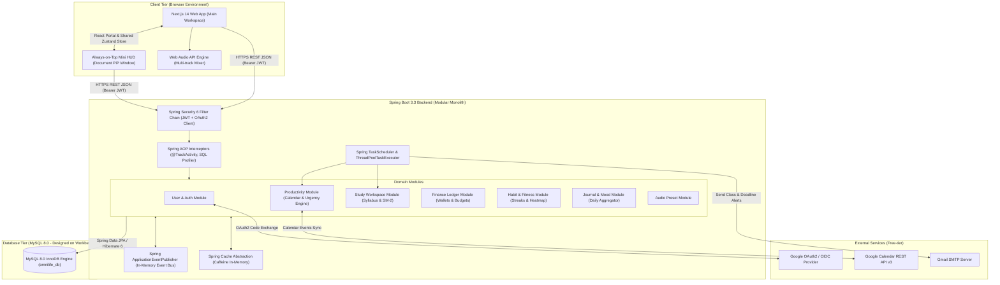
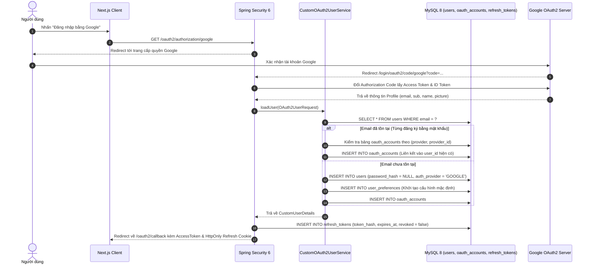
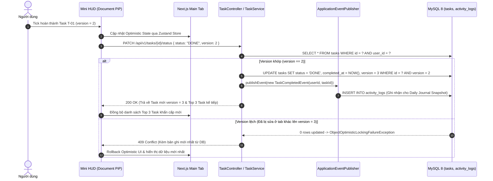
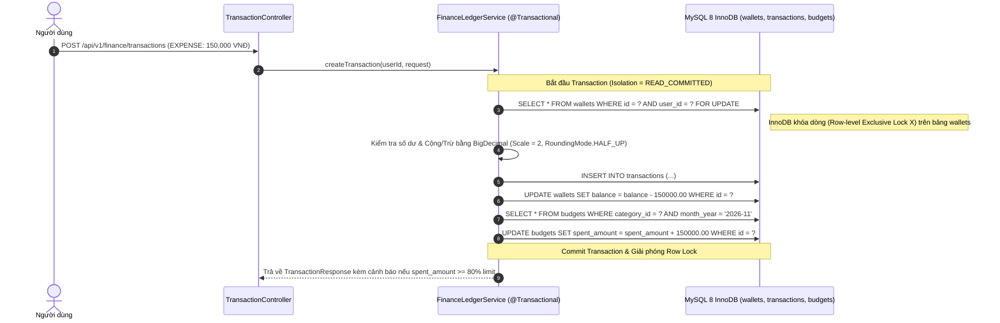

# System Architecture Specification - OmniLife Personal OS

## 1. Tổng Quan Kiến Trúc Hệ Thống (High-Level Architecture)

**OmniLife** được thiết kế theo mô hình **Modular Monolith ở phía Backend (Spring Boot 3.3)** kết hợp với **Single-Page / Hybrid Application ở phía Frontend (Next.js 14 App Router)** và **Cửa sổ nổi độc lập (Always-on-Top Document Picture-in-Picture Window)**.

Lý do chọn **Modular Monolith** thay vì Microservices hay Layered Monolith truyền thống:
1. **Phù hợp tuyệt đối với Solo Developer & Hạ tầng Free-tier:** Chỉ cần đóng gói và triển khai một tiến trình JVM duy nhất (1 Docker Container) và một MySQL Schema duy nhất, tiết kiệm tối đa RAM và chi phí vận hành.
2. **Ranh giới nghiệp vụ rõ ràng (High Cohesion, Low Coupling):** Mã nguồn được chia theo từng Domain (`user`, `productivity`, `study`, `finance`, `habit`, `journal`, `audio`). Các module không gọi trực tiếp `Repository` của nhau mà giao tiếp thông qua **Public Service Interface** hoặc **Spring Domain Events (`ApplicationEventPublisher`)**.
3. **Đảm bảo tính toàn vẹn ACID của MySQL:** Dễ dàng quản lý `@Transactional` xuyên suốt các thao tác phức tạp mà không cần dùng tới Distributed Transaction (Saga / 2PC).

---

## 2. Sơ Đồ Luồng Dữ Liệu Cốt Lõi (Core Data Flows)

### 2.1. Luồng Xác Thực Kép, Tự Động Liên Kết Tài Khoản & Làm Mới Token (OAuth2 + Local Auth + JWT Rotation)

### 2.2. Luồng Tương Tác Cửa Sổ Nổi Mini HUD & Kiểm Soát Xung Đột (Optimistic Locking)

### 2.3. Luồng Giao Dịch Sổ Cái Tài Chính Với Khóa Bi Quan (Pessimistic Write Lock)

---

## 3. Giải Phẫu Bản Chất Spring Boot 3 Trong OmniLife

Dự án được thiết kế để bạn thực hành trực tiếp và nắm rõ bản chất của 7 cơ chế cốt lõi trong Spring Boot:

### 3.1. IoC Container, Dependency Injection & Strategy Pattern
- Toàn bộ các `Service`, `Repository`, `Controller` được quản lý dưới dạng Singleton Bean trong `ApplicationContext`.
- **Thực hành Constructor Injection:** Tuyệt đối không sử dụng `@Autowired` trên biến thành viên (Field Injection). Toàn bộ các class sử dụng `final` fields kết hợp Constructor (hoặc `@RequiredArgsConstructor` của Lombok) để đảm bảo tính bất biến (Immutability) và dễ dàng khởi tạo Mock Object khi viết Unit Test với JUnit 5.
- **Áp dụng Strategy Pattern qua DI:** Trong module `productivity`, hệ thống cho phép tính điểm khẩn cấp hoặc sắp xếp công việc theo các chiến lược khác nhau bằng cách inject `Map<String, UrgencyCalculationStrategy>` trực tiếp vào Service.

### 3.2. Cơ Chế Spring AOP Proxy & Giải Quyết Bẫy Self-Invocation
- **Cách ứng dụng:** Hệ thống định nghĩa custom annotation `@TrackActivity(domain = ActivityDomain.STUDY, action = "COMPLETE_REVIEW")` và class `ActivityAuditAspect` sử dụng `@AfterReturning` để tự động lưu lịch sử hoạt động vào bảng `activity_logs` mỗi khi người dùng hoàn thành một task, ôn xong một bài học hoặc ghi nhận một thói quen.
- **Hiểu sâu bản chất Proxy:** Spring Boot 3 sử dụng **CGLIB Proxy** làm mặc định (tạo một subclass kế thừa class Service của bạn tại thời điểm runtime để chèn logic `@Transactional`, `@Async`, `@Cacheable` vào trước và sau lời gọi hàm).
- **Quy tắc chống lỗi Self-Invocation:** Trong `TaskService`, nếu hàm `createBatchTasks()` gọi trực tiếp hàm `this.createSingleTask()` (có gắn `@Transactional`), lời gọi đó sẽ đi qua con trỏ `this` thay vì đi qua đối tượng CGLIB Proxy, làm vô hiệu hóa Transaction. Kiến trúc OmniLife tách riêng `TaskCommandService` và `TaskQueryService` để mọi lời gọi luôn đi xuyên qua Spring Proxy chuẩn xác.

### 3.3. Quản Lý Transaction (`@Transactional`) & Mức Độ Cô Lập (Isolation Levels)
- **Read-Write vs Read-Only Transaction:**
  - Mặc định ở tầng Service đọc dữ liệu (`getDashboardSummary`, `getCalendarEvents`, `getMonthlyCashflow`), bắt buộc gắn `@Transactional(readOnly = true)`.
  - *Bản chất bên dưới:* Khi `readOnly = true`, Hibernate sẽ tắt cơ chế **Dirty Checking** (không cần giữ bản sao Snapshot của Entity trong bộ nhớ Persistence Context để so sánh sự thay đổi khi kết thúc hàm), giúp giảm 30-40% lượng RAM tiêu thụ và tăng tốc độ phản hồi.
- **Rollback Rules:** Mặc định Spring chỉ tự động rollback khi gặp `RuntimeException` (Unchecked Exception) và không rollback khi gặp Checked Exception (như `IOException` khi đọc file PDF đề cương). Do đó, mọi phương thức ghi dữ liệu đều được khai báo tường minh `@Transactional(rollbackFor = Exception.class)`.

### 3.4. Tối Ưu Hóa Hibernate 6 & Triệt Tiêu Lỗi N+1 Query
- **Quy tắc Mandatory Lazy Loading:** Mọi mối quan hệ `@ManyToOne` và `@OneToMany` trong các Entity của OmniLife bắt buộc khai báo `fetch = FetchType.LAZY` (vì mặc định của JPA cho `@ManyToOne` là `EAGER`, nguyên nhân số một gây ra hàng chục câu lệnh SELECT thừa).
- **Giải pháp lấy dữ liệu kèm quan hệ:**
  1. Sử dụng `@EntityGraph(attributePaths = {"subtasks", "course"})` trực tiếp trên các hàm truy vấn của `TaskRepository`.
  2. Sử dụng **Java Record DTO Projection** (`SELECT new com.omnilife.productivity.dto.TaskSummaryProjection(...)`) cho các API thống kê và bảng xếp hạng để Hibernate chỉ `SELECT` đúng các cột cần thiết thay vì kéo toàn bộ Entity.

### 3.5. Kiến Trúc Hướng Sự Kiện Nội Bộ (Domain Events với `@TransactionalEventListener`)
- Để trang **Daily Journal** cuối ngày tự động biết hôm nay bạn đã hoàn thành những việc gì mà không làm cho `TaskService`, `StudyService`, `FinanceService` bị phụ thuộc chéo vào `JournalService`:
  - Khi hoàn thành Task, `TaskService` chỉ cần gọi `eventPublisher.publishEvent(new ActivityRecordedEvent(...))`.
  - Ở phía nhận, `ActivityEventListener` sử dụng `@TransactionalEventListener(phase = TransactionPhase.AFTER_COMMIT)` kết hợp `@Async("applicationTaskExecutor")` để chỉ ghi nhận hoạt động sau khi Transaction chính đã commit thành công xuống MySQL và chạy trên luồng phụ không làm chậm phản hồi của người dùng.

### 3.6. Tiến Trình Ngầm & Đa Luồng (`@Scheduled` & `ThreadPoolTaskExecutor`)
- Thay vì dùng `SimpleAsyncTaskExecutor` mặc định của Spring (vốn tạo mới thread không giới hạn mỗi lần gọi `@Async`), OmniLife cấu hình tường minh một `ThreadPoolTaskExecutor` trong `AsyncConfig`:
  - `corePoolSize = 4`, `maxPoolSize = 8`, `queueCapacity = 100`, `threadNamePrefix = "OmniLife-Async-"`.
- Hai bộ lập lịch `@Scheduled` chính:
  1. `TaskUrgencyRecalculationScheduler`: Chạy mỗi 15 phút (`cron = "0 */15 * * * *"`) để cập nhật lại cột `urgency_score` và `urgency_tier` cho các công việc đang mở, giúp việc sắp xếp và lọc bằng SQL Index trên MySQL đạt tốc độ tối đa.
  2. `ClassReminderNotificationScheduler`: Chạy mỗi 5 phút kiểm tra bảng `class_schedules` và gửi email/thông báo cho các lớp học sắp bắt đầu trong 30 phút tới.

---

## 4. Kiến Trúc Cửa Sổ Nổi Always-on-Top Mini HUD (Document PiP Architecture)

Tính năng cửa sổ nhỏ luôn nổi trên màn hình máy tính khi rời giao diện web được hiện thực hóa bằng kiến trúc **Cross-Window React Portal**:

1. **Khởi tạo cửa sổ cấp hệ điều hành:** Khi người dùng nhấn nút mở Mini HUD, hook `useDocumentPip.ts` gọi `await window.documentPictureInPicture.requestWindow({ width: 340, height: 460 })`. Trình duyệt tạo ra một cửa sổ `Window` mới luôn ghim trên cùng (Always-on-top) ở tầng hệ điều hành.
2. **Sao chép toàn bộ Style Sheets:** Hệ thống tự động duyệt qua `document.styleSheets` của cửa sổ chính và clone toàn bộ thẻ `<link rel="stylesheet">` cùng các biến CSS Tailwind sang `pipWindow.document.head`.
3. **Đồng bộ Trạng thái bằng React Portal:** Thay vì tải lại một trang web mới trong cửa sổ con (gây tốn RAM và mất kết nối âm thanh), component `<StickyMiniHudWindow />` được render thông qua `createPortal(<StickyMiniHudWindow />, pipWindow.document.body)`. Nhờ đó, cửa sổ nổi và trang web chính dùng chung một bộ nhớ Zustand Store và TanStack Query Cache: bấm nút trên Mini HUD thì trang chính cập nhật ngay lập tức trong `0ms` mà không cần cơ chế polling phức tạp.
