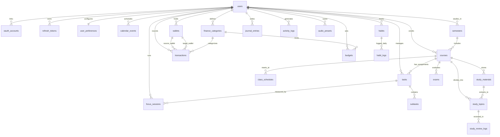

# Database Specification & MySQL Workbench Guide - OmniLife Personal OS

## 1. Quy Chuẩn Thiết Kế Cơ Sở Dữ Liệu (Database Standards)

- **Hệ quản trị CSDL:** MySQL 8.0+
- **Storage Engine:** `InnoDB` (Bắt buộc cho toàn bộ bảng để hỗ trợ ACID Transactions, Row-level Locking `SELECT ... FOR UPDATE` và Foreign Key Constraints).
- **Character Set & Collation:** `utf8mb4` / `utf8mb4_unicode_ci` (Hỗ trợ đầy đủ tiếng Việt và ký tự đặc biệt).
- **Quy ước khóa chính (Primary Key):** Sử dụng `BIGINT UNSIGNED AUTO_INCREMENT` để tối ưu hóa kích thước Clustering Index (B+Tree) của InnoDB.
- **Quy ước tiền tệ (Monetary Values):** Tuyệt đối không dùng `FLOAT` hoặc `DOUBLE`. Bắt buộc sử dụng `DECIMAL(15, 2)` để không bao giờ xảy ra sai số dấu phẩy động.
- **Quy ước thời gian:** Toàn bộ cột `DATETIME` và `TIMESTAMP` lưu trữ theo múi giờ chuẩn `UTC`, chuyển đổi sang múi giờ của người dùng (`Asia/Ho_Chi_Minh`) ở tầng hiển thị.

---

## 2. Sơ Đồ Thực Thể Quan Hệ Tổng Thể (Entity-Relationship Diagram)



---

## 3. Đặc Tả Chi Tiết 24 Bảng Dữ Liệu (Complete Table Specifications)

### 3.1. Phân hệ Xác Thực & Người Dùng (Auth & User Domain)

#### Bảng 1: `users` (Thông tin tài khoản người dùng)
| Tên cột | Kiểu dữ liệu | Ràng buộc (Constraints) | Mô tả chi tiết |
| :--- | :--- | :--- | :--- |
| `id` | `BIGINT UNSIGNED` | `PK`, `AUTO_INCREMENT` | Định danh duy nhất của người dùng |
| `email` | `VARCHAR(150)` | `NOT NULL`, `UNIQUE` | Địa chỉ email đăng nhập |
| `password_hash` | `VARCHAR(255)` | `NULL` | Chuỗi băm BCrypt (`NULL` nếu chỉ đăng nhập qua Google OAuth2) |
| `full_name` | `VARCHAR(100)` | `NOT NULL` | Họ và tên hiển thị |
| `avatar_url` | `VARCHAR(500)` | `NULL` | Đường dẫn ảnh đại diện |
| `auth_provider` | `VARCHAR(20)` | `NOT NULL`, `DEFAULT 'LOCAL'` | Phương thức tạo tài khoản gốc (`LOCAL`, `GOOGLE`, `LINKED`) |
| `is_active` | `TINYINT(1)` | `NOT NULL`, `DEFAULT 1` | Trạng thái hoạt động của tài khoản (`1`: Active, `0`: Locked) |
| `created_at` | `DATETIME` | `NOT NULL`, `DEFAULT CURRENT_TIMESTAMP` | Thời điểm tạo tài khoản |
| `updated_at` | `DATETIME` | `NOT NULL`, `ON UPDATE CURRENT_TIMESTAMP` | Thời điểm cập nhật gần nhất |

#### Bảng 2: `oauth_accounts` (Liên kết tài khoản mạng xã hội Google OAuth2)
| Tên cột | Kiểu dữ liệu | Ràng buộc (Constraints) | Mô tả chi tiết |
| :--- | :--- | :--- | :--- |
| `id` | `BIGINT UNSIGNED` | `PK`, `AUTO_INCREMENT` | Định danh bản ghi liên kết OAuth2 |
| `user_id` | `BIGINT UNSIGNED` | `FK (users.id) ON DELETE CASCADE`, `NOT NULL` | Khóa ngoại trỏ tới người dùng sở hữu |
| `provider` | `VARCHAR(30)` | `NOT NULL` | Tên nhà cung cấp (`GOOGLE`) |
| `provider_account_id` | `VARCHAR(150)` | `NOT NULL` | Mã định danh `sub` trả về từ Google OpenID Connect |
| `access_token` | `TEXT` | `NULL` | OAuth2 Access Token phục vụ đồng bộ Google Calendar |
| `refresh_token` | `TEXT` | `NULL` | OAuth2 Refresh Token phục vụ đồng bộ dài hạn |
| `token_expires_at` | `DATETIME` | `NULL` | Thời điểm hết hạn của Google Access Token |
| `created_at` | `DATETIME` | `NOT NULL`, `DEFAULT CURRENT_TIMESTAMP` | Thời điểm liên kết |
*Unique Constraint:* `uk_oauth_provider_account (provider, provider_account_id)`

#### Bảng 3: `refresh_tokens` (Quản lý phiên đăng nhập và xoay vòng JWT Refresh Token)
| Tên cột | Kiểu dữ liệu | Ràng buộc (Constraints) | Mô tả chi tiết |
| :--- | :--- | :--- | :--- |
| `id` | `BIGINT UNSIGNED` | `PK`, `AUTO_INCREMENT` | Định danh Refresh Token |
| `user_id` | `BIGINT UNSIGNED` | `FK (users.id) ON DELETE CASCADE`, `NOT NULL` | Người dùng sở hữu phiên đăng nhập |
| `token_hash` | `VARCHAR(128)` | `NOT NULL`, `UNIQUE` | Chuỗi băm SHA-256 của Refresh Token |
| `device_info` | `VARCHAR(255)` | `NULL` | Thông tin trình duyệt / hệ điều hành (`User-Agent`) |
| `expires_at` | `DATETIME` | `NOT NULL` | Thời điểm hết hạn của Refresh Token |
| `is_revoked` | `TINYINT(1)` | `NOT NULL`, `DEFAULT 0` | Đánh dấu token đã bị thu hồi (`1`) hay còn hiệu lực (`0`) |
| `created_at` | `DATETIME` | `NOT NULL`, `DEFAULT CURRENT_TIMESTAMP` | Thời điểm cấp phát |

#### Bảng 4: `user_preferences` (Cấu hình cá nhân hóa giao diện & trọng số tính điểm)
| Tên cột | Kiểu dữ liệu | Ràng buộc (Constraints) | Mô tả chi tiết |
| :--- | :--- | :--- | :--- |
| `user_id` | `BIGINT UNSIGNED` | `PK`, `FK (users.id) ON DELETE CASCADE` | Khóa chính kiêm khóa ngoại 1-1 với `users` |
| `theme_mode` | `VARCHAR(20)` | `NOT NULL`, `DEFAULT 'DARK'` | Giao diện (`DARK`, `LIGHT`, `SYSTEM`) |
| `timezone` | `VARCHAR(64)` | `NOT NULL`, `DEFAULT 'Asia/Ho_Chi_Minh'` | Múi giờ hiển thị |
| `daily_focus_goal_mins` | `INT` | `NOT NULL`, `DEFAULT 240` | Mục tiêu số phút học/tập trung mỗi ngày |
| `pomodoro_work_mins` | `INT` | `NOT NULL`, `DEFAULT 25` | Thời lượng 1 phiên Pomodoro chuẩn (phút) |
| `pomodoro_short_break_mins` | `INT` | `NOT NULL`, `DEFAULT 5` | Thời lượng nghỉ ngắn (phút) |
| `pomodoro_long_break_mins` | `INT` | `NOT NULL`, `DEFAULT 15` | Thời lượng nghỉ dài sau 4 phiên (phút) |
| `urgency_weights_json` | `JSON` | `NOT NULL` | Lưu trọng số tùy chỉnh cho công thức tính điểm khẩn cấp |
| `dashboard_layout_json` | `JSON` | `NULL` | Lưu cấu hình vị trí các Bento Widget trên Dashboard |
| `updated_at` | `DATETIME` | `NOT NULL`, `ON UPDATE CURRENT_TIMESTAMP` | Thời điểm cập nhật |

---

### 3.2. Phân hệ Lịch Biểu & Động Cơ Công Việc (Productivity Domain)

#### Bảng 5: `tasks` (Công việc và điểm khẩn cấp động)
| Tên cột | Kiểu dữ liệu | Ràng buộc (Constraints) | Mô tả chi tiết |
| :--- | :--- | :--- | :--- |
| `id` | `BIGINT UNSIGNED` | `PK`, `AUTO_INCREMENT` | Định danh công việc |
| `user_id` | `BIGINT UNSIGNED` | `FK (users.id) ON DELETE CASCADE`, `NOT NULL` | Người dùng sở hữu |
| `course_id` | `BIGINT UNSIGNED` | `FK (courses.id) ON DELETE SET NULL`, `NULL` | Liên kết với môn học (nếu là bài tập trên trường) |
| `title` | `VARCHAR(255)` | `NOT NULL` | Tiêu đề công việc |
| `description` | `TEXT` | `NULL` | Mô tả chi tiết định dạng Markdown |
| `status` | `VARCHAR(20)` | `NOT NULL`, `DEFAULT 'TODO'` | Trạng thái (`TODO`, `IN_PROGRESS`, `DONE`, `ARCHIVED`) |
| `base_priority` | `VARCHAR(20)` | `NOT NULL`, `DEFAULT 'MEDIUM'` | Độ ưu tiên gốc (`LOW`, `MEDIUM`, `HIGH`, `CRITICAL`) |
| `estimated_minutes` | `INT` | `NOT NULL`, `DEFAULT 30` | Thời gian ước tính hoàn thành (phút) |
| `actual_focused_minutes` | `INT` | `NOT NULL`, `DEFAULT 0` | Tổng số phút thực tế đã chạy Pomodoro cho công việc này |
| `due_at` | `DATETIME` | `NULL` | Hạn chót hoàn thành (Deadline) |
| `scheduled_start_at` | `DATETIME` | `NULL` | Thời điểm bắt đầu làm việc dự kiến trên Lịch (Time-blocking) |
| `scheduled_end_at` | `DATETIME` | `NULL` | Thời điểm kết thúc làm việc dự kiến trên Lịch |
| `urgency_score` | `DECIMAL(5,2)` | `NOT NULL`, `DEFAULT 25.00` | Điểm khẩn cấp động ($0.00 \rightarrow 100.00$) |
| `urgency_tier` | `VARCHAR(20)` | `NOT NULL`, `DEFAULT 'LOW'` | Cấp độ khẩn cấp (`OVERDUE`, `EXTREME`, `HIGH`, `MODERATE`, `LOW`) |
| `tags_json` | `JSON` | `NULL` | Mảng các nhãn đính kèm (ví dụ: `["backend", "exam"]`) |
| `is_pinned_hud` | `TINYINT(1)` | `NOT NULL`, `DEFAULT 0` | Ghim cưỡng bức lên cửa sổ nổi Mini HUD (`1`: Ghim) |
| `completed_at` | `DATETIME` | `NULL` | Thời điểm đánh dấu hoàn thành |
| `is_deleted` | `TINYINT(1)` | `NOT NULL`, `DEFAULT 0` | Cờ xóa mềm (Soft Delete) |
| `version` | `BIGINT` | `NOT NULL`, `DEFAULT 0` | Cột kiểm soát Optimistic Locking (`@Version` trong JPA) |
| `created_at` | `DATETIME` | `NOT NULL`, `DEFAULT CURRENT_TIMESTAMP` | Thời điểm tạo |
| `updated_at` | `DATETIME` | `NOT NULL`, `ON UPDATE CURRENT_TIMESTAMP` | Thời điểm cập nhật |

#### Bảng 6: `subtasks` (Các bước nhỏ trong một công việc chính)
| Tên cột | Kiểu dữ liệu | Ràng buộc (Constraints) | Mô tả chi tiết |
| :--- | :--- | :--- | :--- |
| `id` | `BIGINT UNSIGNED` | `PK`, `AUTO_INCREMENT` | Định danh subtask |
| `task_id` | `BIGINT UNSIGNED` | `FK (tasks.id) ON DELETE CASCADE`, `NOT NULL` | Công việc cha |
| `title` | `VARCHAR(255)` | `NOT NULL` | Nội dung bước nhỏ |
| `is_completed` | `TINYINT(1)` | `NOT NULL`, `DEFAULT 0` | Trạng thái hoàn thành (`0` hoặc `1`) |
| `sort_order` | `INT` | `NOT NULL`, `DEFAULT 0` | Thứ tự hiển thị từ trên xuống dưới |
| `created_at` | `DATETIME` | `NOT NULL`, `DEFAULT CURRENT_TIMESTAMP` | Thời điểm tạo |

#### Bảng 7: `calendar_events` (Sự kiện lịch biểu & Đồng bộ Google Calendar)
| Tên cột | Kiểu dữ liệu | Ràng buộc (Constraints) | Mô tả chi tiết |
| :--- | :--- | :--- | :--- |
| `id` | `BIGINT UNSIGNED` | `PK`, `AUTO_INCREMENT` | Định danh sự kiện |
| `user_id` | `BIGINT UNSIGNED` | `FK (users.id) ON DELETE CASCADE`, `NOT NULL` | Người dùng sở hữu |
| `google_event_id` | `VARCHAR(255)` | `NULL` | ID sự kiện gốc từ Google Calendar (để chống trùng khi đồng bộ) |
| `title` | `VARCHAR(255)` | `NOT NULL` | Tên sự kiện |
| `description` | `TEXT` | `NULL` | Ghi chú sự kiện |
| `location` | `VARCHAR(255)` | `NULL` | Địa điểm hoặc link phòng họp trực tuyến |
| `start_at` | `DATETIME` | `NOT NULL` | Thời điểm bắt đầu |
| `end_at` | `DATETIME` | `NOT NULL` | Thời điểm kết thúc |
| `is_all_day` | `TINYINT(1)` | `NOT NULL`, `DEFAULT 0` | Sự kiện cả ngày (`1`) hay theo giờ (`0`) |
| `color_hex` | `VARCHAR(10)` | `NOT NULL`, `DEFAULT '#3B82F6'` | Mã màu hiển thị trên lịch |
| `source` | `VARCHAR(20)` | `NOT NULL`, `DEFAULT 'LOCAL'` | Nguồn tạo (`LOCAL`, `GOOGLE_SYNC`) |
| `created_at` | `DATETIME` | `NOT NULL`, `DEFAULT CURRENT_TIMESTAMP` | Thời điểm tạo |
| `updated_at` | `DATETIME` | `NOT NULL`, `ON UPDATE CURRENT_TIMESTAMP` | Thời điểm cập nhật |

#### Bảng 8: `focus_sessions` (Lịch sử các phiên tập trung Pomodoro)
| Tên cột | Kiểu dữ liệu | Ràng buộc (Constraints) | Mô tả chi tiết |
| :--- | :--- | :--- | :--- |
| `id` | `BIGINT UNSIGNED` | `PK`, `AUTO_INCREMENT` | Định danh phiên tập trung |
| `user_id` | `BIGINT UNSIGNED` | `FK (users.id) ON DELETE CASCADE`, `NOT NULL` | Người dùng thực hiện |
| `task_id` | `BIGINT UNSIGNED` | `FK (tasks.id) ON DELETE SET NULL`, `NULL` | Công việc đang làm trong phiên Pomodoro |
| `course_id` | `BIGINT UNSIGNED` | `FK (courses.id) ON DELETE SET NULL`, `NULL` | Môn học đang ôn trong phiên Pomodoro |
| `planned_minutes` | `INT` | `NOT NULL` | Số phút đặt mục tiêu (ví dụ: 25 phút) |
| `completed_minutes` | `INT` | `NOT NULL` | Số phút thực tế đã hoàn thành |
| `status` | `VARCHAR(20)` | `NOT NULL` | Kết quả phiên (`COMPLETED`, `INTERRUPTED`) |
| `started_at` | `DATETIME` | `NOT NULL` | Thời điểm bấm bắt đầu |
| `ended_at` | `DATETIME` | `NULL` | Thời điểm kết thúc |

---

### 3.3. Phân hệ Không Gian Học Tập Chuyên Sâu (Study Workspace Domain)

#### Bảng 9: `semesters` (Học kỳ đại học)
| Tên cột | Kiểu dữ liệu | Ràng buộc (Constraints) | Mô tả chi tiết |
| :--- | :--- | :--- | :--- |
| `id` | `BIGINT UNSIGNED` | `PK`, `AUTO_INCREMENT` | Định danh học kỳ |
| `user_id` | `BIGINT UNSIGNED` | `FK (users.id) ON DELETE CASCADE`, `NOT NULL` | Người dùng sở hữu |
| `name` | `VARCHAR(100)` | `NOT NULL` | Tên học kỳ (ví dụ: `Học kỳ 1 - 2026/2027`) |
| `start_date` | `DATE` | `NOT NULL` | Ngày bắt đầu học kỳ |
| `end_date` | `DATE` | `NOT NULL` | Ngày kết thúc học kỳ |
| `target_gpa` | `DECIMAL(3,2)` | `NULL` | Điểm trung bình mục tiêu (ví dụ: `3.60`) |
| `is_current` | `TINYINT(1)` | `NOT NULL`, `DEFAULT 0` | Đánh dấu học kỳ hiện tại (`1`) |

#### Bảng 10: `courses` (Môn học trong học kỳ)
| Tên cột | Kiểu dữ liệu | Ràng buộc (Constraints) | Mô tả chi tiết |
| :--- | :--- | :--- | :--- |
| `id` | `BIGINT UNSIGNED` | `PK`, `AUTO_INCREMENT` | Định danh môn học |
| `user_id` | `BIGINT UNSIGNED` | `FK (users.id) ON DELETE CASCADE`, `NOT NULL` | Người dùng sở hữu |
| `semester_id` | `BIGINT UNSIGNED` | `FK (semesters.id) ON DELETE CASCADE`, `NOT NULL` | Thuộc học kỳ nào |
| `course_code` | `VARCHAR(30)` | `NOT NULL` | Mã học phần (ví dụ: `IT4090`) |
| `name` | `VARCHAR(150)` | `NOT NULL` | Tên môn học |
| `credits` | `INT` | `NOT NULL`, `DEFAULT 3` | Số tín chỉ |
| `instructor_name` | `VARCHAR(100)` | `NULL` | Tên giảng viên hướng dẫn |
| `room_location` | `VARCHAR(100)` | `NULL` | Phòng học mặc định |
| `target_grade` | `DECIMAL(4,2)` | `NULL` | Điểm số mục tiêu (thang 10 hoặc thang 4) |
| `color_hex` | `VARCHAR(10)` | `NOT NULL`, `DEFAULT '#6366F1'` | Màu sắc nhận diện môn học |
| `created_at` | `DATETIME` | `NOT NULL`, `DEFAULT CURRENT_TIMESTAMP` | Thời điểm tạo |

#### Bảng 11: `class_schedules` (Thời khóa biểu lịch học cố định hàng tuần)
| Tên cột | Kiểu dữ liệu | Ràng buộc (Constraints) | Mô tả chi tiết |
| :--- | :--- | :--- | :--- |
| `id` | `BIGINT UNSIGNED` | `PK`, `AUTO_INCREMENT` | Định danh buổi học trong tuần |
| `course_id` | `BIGINT UNSIGNED` | `FK (courses.id) ON DELETE CASCADE`, `NOT NULL` | Môn học |
| `day_of_week` | `TINYINT` | `NOT NULL`, `CHECK (day_of_week BETWEEN 1 AND 7)` | Thứ trong tuần (`1`: Thứ Hai -> `7`: Chủ Nhật theo chuẩn ISO-8601) |
| `start_time` | `TIME` | `NOT NULL` | Giờ vào lớp (ví dụ: `07:30:00`) |
| `end_time` | `TIME` | `NOT NULL` | Giờ tan lớp (ví dụ: `10:00:00`) |
| `room` | `VARCHAR(50)` | `NULL` | Phòng học cụ thể của ca học |
| `remind_before_mins` | `INT` | `NOT NULL`, `DEFAULT 30` | Nhắc nhở trước bao nhiêu phút |

#### Bảng 12: `study_materials` (Tài liệu học tập & Đề cương đã tải lên)
| Tên cột | Kiểu dữ liệu | Ràng buộc (Constraints) | Mô tả chi tiết |
| :--- | :--- | :--- | :--- |
| `id` | `BIGINT UNSIGNED` | `PK`, `AUTO_INCREMENT` | Định danh tài liệu |
| `course_id` | `BIGINT UNSIGNED` | `FK (courses.id) ON DELETE CASCADE`, `NOT NULL` | Thuộc môn học nào |
| `title` | `VARCHAR(255)` | `NOT NULL` | Tên tài liệu / giáo trình |
| `file_name` | `VARCHAR(255)` | `NULL` | Tên file gốc tải lên |
| `file_type` | `VARCHAR(30)` | `NOT NULL` | Định dạng (`PDF`, `DOCX`, `MARKDOWN`, `EXTERNAL_URL`) |
| `extracted_outline_text` | `LONGTEXT` | `NULL` | Nội dung mục lục/văn bản đã bóc tách để chia thành các chủ đề học |
| `total_topics_count` | `INT` | `NOT NULL`, `DEFAULT 0` | Tổng số chủ đề học tập được trích xuất từ tài liệu này |
| `created_at` | `DATETIME` | `NOT NULL`, `DEFAULT CURRENT_TIMESTAMP` | Thời điểm tải lên |

#### Bảng 13: `study_topics` (Đơn vị kiến thức & Trạng thái ôn tập Spaced Repetition SM-2)
| Tên cột | Kiểu dữ liệu | Ràng buộc (Constraints) | Mô tả chi tiết |
| :--- | :--- | :--- | :--- |
| `id` | `BIGINT UNSIGNED` | `PK`, `AUTO_INCREMENT` | Định danh chủ đề kiến thức |
| `user_id` | `BIGINT UNSIGNED` | `FK (users.id) ON DELETE CASCADE`, `NOT NULL` | Người dùng sở hữu |
| `course_id` | `BIGINT UNSIGNED` | `FK (courses.id) ON DELETE CASCADE`, `NOT NULL` | Thuộc môn học nào |
| `material_id` | `BIGINT UNSIGNED` | `FK (study_materials.id) ON DELETE SET NULL`, `NULL` | Trích xuất từ tài liệu nào |
| `chapter_title` | `VARCHAR(255)` | `NOT NULL` | Tên chương / chuyên đề cần học |
| `summary_notes` | `TEXT` | `NULL` | Ghi chú trọng tâm / công thức tóm tắt bằng Markdown |
| `mastery_level` | `VARCHAR(20)` | `NOT NULL`, `DEFAULT 'NEW'` | Mức độ nắm vững (`NEW`, `LEARNING`, `REVIEWING`, `MASTERED`) |
| `repetition_count` | `INT` | `NOT NULL`, `DEFAULT 0` | Tham số $n$: Số lần nhớ liên tiếp trong thuật toán SM-2 |
| `easiness_factor` | `DECIMAL(4,2)` | `NOT NULL`, `DEFAULT 2.50` | Tham số $EF$: Hệ số dễ nhớ ($\ge 1.30$) |
| `interval_days` | `INT` | `NOT NULL`, `DEFAULT 0` | Tham số $I$: Khoảng cách số ngày giữa 2 lần ôn |
| `planned_study_date` | `DATE` | `NULL` | Ngày dự kiến học mới lần đầu |
| `last_reviewed_at` | `DATETIME` | `NULL` | Thời điểm ôn tập gần nhất |
| `next_review_date` | `DATE` | `NULL` | Ngày bắt buộc phải ôn lại bài cũ tiếp theo |
| `is_exam_scope` | `TINYINT(1)` | `NOT NULL`, `DEFAULT 1` | Thuộc phạm vi trọng tâm ôn thi (`1`: Có) |
| `sort_order` | `INT` | `NOT NULL`, `DEFAULT 0` | Thứ tự chương mục |

#### Bảng 14: `study_review_logs` (Lịch sử các lần tự kiểm tra & ôn bài cũ)
| Tên cột | Kiểu dữ liệu | Ràng buộc (Constraints) | Mô tả chi tiết |
| :--- | :--- | :--- | :--- |
| `id` | `BIGINT UNSIGNED` | `PK`, `AUTO_INCREMENT` | Định danh lượt ôn tập |
| `topic_id` | `BIGINT UNSIGNED` | `FK (study_topics.id) ON DELETE CASCADE`, `NOT NULL` | Chủ đề đã ôn tập |
| `quality_rating` | `TINYINT` | `NOT NULL`, `CHECK (quality_rating BETWEEN 0 AND 5)` | Điểm tự đánh giá mức độ nhớ $q \in [0, 5]$ |
| `previous_interval_days` | `INT` | `NOT NULL` | Khoảng cách ngày trước khi ôn |
| `new_interval_days` | `INT` | `NOT NULL` | Khoảng cách ngày mới sau khi tính SM-2 |
| `new_easiness_factor` | `DECIMAL(4,2)` | `NOT NULL` | Hệ số $EF$ mới sau khi tính SM-2 |
| `reviewed_at` | `DATETIME` | `NOT NULL`, `DEFAULT CURRENT_TIMESTAMP` | Thời điểm hoàn thành ôn tập |

#### Bảng 15: `exams` (Lịch thi & Đếm ngược kỳ thi)
| Tên cột | Kiểu dữ liệu | Ràng buộc (Constraints) | Mô tả chi tiết |
| :--- | :--- | :--- | :--- |
| `id` | `BIGINT UNSIGNED` | `PK`, `AUTO_INCREMENT` | Định danh kỳ thi |
| `user_id` | `BIGINT UNSIGNED` | `FK (users.id) ON DELETE CASCADE`, `NOT NULL` | Người dùng |
| `course_id` | `BIGINT UNSIGNED` | `FK (courses.id) ON DELETE CASCADE`, `NOT NULL` | Môn thi |
| `title` | `VARCHAR(150)` | `NOT NULL` | Tên kỳ thi (ví dụ: `Thi Cuối Kỳ`, `Thi Giữa Kỳ`) |
| `exam_type` | `VARCHAR(30)` | `NOT NULL` | Hình thức (`WRITTEN`, `MULTIPLE_CHOICE`, `PRACTICAL`, `ORAL`) |
| `exam_at` | `DATETIME` | `NOT NULL` | Ngày giờ thi chính thức |
| `room` | `VARCHAR(100)` | `NULL` | Phòng thi |
| `weight_percentage` | `INT` | `NOT NULL`, `DEFAULT 50` | Trọng số điểm kỳ thi (ví dụ: `60%`) |
| `notes` | `TEXT` | `NULL` | Quy định phòng thi, tài liệu được phép mang vào |

---

### 3.4. Phân hệ Quản Lý Tài Chính Cá Nhân (Finance Ledger Domain)

#### Bảng 16: `wallets` (Ví tiền / Tài khoản thanh toán)
| Tên cột | Kiểu dữ liệu | Ràng buộc (Constraints) | Mô tả chi tiết |
| :--- | :--- | :--- | :--- |
| `id` | `BIGINT UNSIGNED` | `PK`, `AUTO_INCREMENT` | Định danh ví |
| `user_id` | `BIGINT UNSIGNED` | `FK (users.id) ON DELETE CASCADE`, `NOT NULL` | Chủ sở hữu ví |
| `name` | `VARCHAR(100)` | `NOT NULL` | Tên ví (`Tiền mặt`, `Vietcombank`, `MoMo`) |
| `wallet_type` | `VARCHAR(30)` | `NOT NULL` | Loại ví (`CASH`, `BANK_ACCOUNT`, `E_WALLET`, `SAVINGS`) |
| `balance` | `DECIMAL(15,2)` | `NOT NULL`, `DEFAULT 0.00` | Số dư hiện tại (cập nhật qua Pessimistic Lock) |
| `currency` | `VARCHAR(10)` | `NOT NULL`, `DEFAULT 'VND'` | Đơn vị tiền tệ |
| `color_hex` | `VARCHAR(10)` | `NOT NULL`, `DEFAULT '#10B981'` | Màu hiển thị thẻ ví |
| `is_archived` | `TINYINT(1)` | `NOT NULL`, `DEFAULT 0` | Trạng thái ẩn ví |
| `version` | `BIGINT` | `NOT NULL`, `DEFAULT 0` | Cột phiên bản hỗ trợ kiểm tra đồng thời |
| `created_at` | `DATETIME` | `NOT NULL`, `DEFAULT CURRENT_TIMESTAMP` | Thời điểm tạo |

#### Bảng 17: `finance_categories` (Danh mục Thu / Chi)
| Tên cột | Kiểu dữ liệu | Ràng buộc (Constraints) | Mô tả chi tiết |
| :--- | :--- | :--- | :--- |
| `id` | `BIGINT UNSIGNED` | `PK`, `AUTO_INCREMENT` | Định danh danh mục |
| `user_id` | `BIGINT UNSIGNED` | `FK (users.id) ON DELETE CASCADE`, `NOT NULL` | Người dùng sở hữu |
| `name` | `VARCHAR(100)` | `NOT NULL` | Tên danh mục (`Ăn uống`, `Học phí`, `Học bổng`, `Làm thêm`) |
| `type` | `VARCHAR(20)` | `NOT NULL` | Loại danh mục (`INCOME`, `EXPENSE`) |
| `icon_name` | `VARCHAR(50)` | `NOT NULL`, `DEFAULT 'Wallet'` | Tên icon Lucide hiển thị |
| `color_hex` | `VARCHAR(10)` | `NOT NULL`, `DEFAULT '#6366F1'` | Màu sắc hiển thị trên biểu đồ tròn |

#### Bảng 18: `transactions` (Sổ cái giao dịch Thu / Chi / Chuyển ví)
| Tên cột | Kiểu dữ liệu | Ràng buộc (Constraints) | Mô tả chi tiết |
| :--- | :--- | :--- | :--- |
| `id` | `BIGINT UNSIGNED` | `PK`, `AUTO_INCREMENT` | Định danh giao dịch |
| `user_id` | `BIGINT UNSIGNED` | `FK (users.id) ON DELETE CASCADE`, `NOT NULL` | Người thực hiện |
| `wallet_id` | `BIGINT UNSIGNED` | `FK (wallets.id) ON DELETE RESTRICT`, `NOT NULL` | Ví nguồn thực hiện giao dịch |
| `target_wallet_id` | `BIGINT UNSIGNED` | `FK (wallets.id) ON DELETE RESTRICT`, `NULL` | Ví đích (chỉ có giá trị khi `type = 'TRANSFER'`) |
| `category_id` | `BIGINT UNSIGNED` | `FK (finance_categories.id) ON DELETE SET NULL`, `NULL` | Danh mục thu/chi |
| `type` | `VARCHAR(20)` | `NOT NULL` | Loại giao dịch (`INCOME`, `EXPENSE`, `TRANSFER`) |
| `amount` | `DECIMAL(15,2)` | `NOT NULL`, `CHECK (amount > 0)` | Số tiền giao dịch (luôn dương) |
| `balance_after` | `DECIMAL(15,2)` | `NOT NULL` | Số dư của ví nguồn ngay sau khi giao dịch hoàn tất (Audit trail) |
| `note` | `VARCHAR(500)` | `NULL` | Nội dung diễn giải giao dịch |
| `transaction_date` | `DATETIME` | `NOT NULL` | Ngày giờ phát sinh giao dịch |
| `created_at` | `DATETIME` | `NOT NULL`, `DEFAULT CURRENT_TIMESTAMP` | Thời điểm ghi sổ |

#### Bảng 19: `budgets` (Hạn mức ngân sách chi tiêu theo tháng)
| Tên cột | Kiểu dữ liệu | Ràng buộc (Constraints) | Mô tả chi tiết |
| :--- | :--- | :--- | :--- |
| `id` | `BIGINT UNSIGNED` | `PK`, `AUTO_INCREMENT` | Định danh ngân sách |
| `user_id` | `BIGINT UNSIGNED` | `FK (users.id) ON DELETE CASCADE`, `NOT NULL` | Người dùng |
| `category_id` | `BIGINT UNSIGNED` | `FK (finance_categories.id) ON DELETE CASCADE`, `NOT NULL` | Danh mục chi tiêu áp dụng hạn mức |
| `month_year` | `CHAR(7)` | `NOT NULL` | Tháng áp dụng theo chuẩn `YYYY-MM` (ví dụ: `'2026-11'`) |
| `limit_amount` | `DECIMAL(15,2)` | `NOT NULL`, `CHECK (limit_amount > 0)` | Số tiền tối đa cho phép chi trong tháng |
| `spent_amount` | `DECIMAL(15,2)` | `NOT NULL`, `DEFAULT 0.00` | Số tiền thực tế đã chi trong tháng |
| `alert_threshold_pct` | `INT` | `NOT NULL`, `DEFAULT 80` | Ngưỡng phần trăm phát cảnh báo (mặc định `80%`) |
*Unique Constraint:* `uk_budget_user_cat_month (user_id, category_id, month_year)`

---

### 3.5. Phân hệ Thói Quen, Nhật Ký & Âm Thanh (Habit, Journal & Audio Domains)

#### Bảng 20: `habits` (Thói quen & Mục tiêu tập luyện thể thao)
| Tên cột | Kiểu dữ liệu | Ràng buộc (Constraints) | Mô tả chi tiết |
| :--- | :--- | :--- | :--- |
| `id` | `BIGINT UNSIGNED` | `PK`, `AUTO_INCREMENT` | Định danh thói quen |
| `user_id` | `BIGINT UNSIGNED` | `FK (users.id) ON DELETE CASCADE`, `NOT NULL` | Người dùng |
| `name` | `VARCHAR(150)` | `NOT NULL` | Tên thói quen (`Chạy bộ 5km`, `Uống 2L nước`, `Tập Gym`) |
| `metric_type` | `VARCHAR(20)` | `NOT NULL`, `DEFAULT 'BOOLEAN'` | Kiểu đo lường (`BOOLEAN`: Đánh dấu xong, `NUMERIC`: Định lượng) |
| `target_value` | `DECIMAL(8,2)` | `NOT NULL`, `DEFAULT 1.00` | Giá trị mục tiêu mỗi ngày (ví dụ: `5.00` km, `2000.00` ml) |
| `unit` | `VARCHAR(30)` | `NULL` | Đơn vị tính (`km`, `ml`, `phút`, `trang`) |
| `current_streak` | `INT` | `NOT NULL`, `DEFAULT 0` | Chuỗi ngày hoàn thành liên tiếp hiện tại |
| `longest_streak` | `INT` | `NOT NULL`, `DEFAULT 0` | Kỷ lục chuỗi ngày dài nhất từ trước tới nay |
| `color_hex` | `VARCHAR(10)` | `NOT NULL`, `DEFAULT '#10B981'` | Màu hiển thị |
| `is_active` | `TINYINT(1)` | `NOT NULL`, `DEFAULT 1` | Còn theo dõi (`1`) hay đã tạm dừng (`0`) |
| `created_at` | `DATETIME` | `NOT NULL`, `DEFAULT CURRENT_TIMESTAMP` | Thời điểm tạo |

#### Bảng 21: `habit_logs` (Nhật ký điểm danh thói quen hàng ngày)
| Tên cột | Kiểu dữ liệu | Ràng buộc (Constraints) | Mô tả chi tiết |
| :--- | :--- | :--- | :--- |
| `id` | `BIGINT UNSIGNED` | `PK`, `AUTO_INCREMENT` | Định danh bản ghi check-in |
| `habit_id` | `BIGINT UNSIGNED` | `FK (habits.id) ON DELETE CASCADE`, `NOT NULL` | Thói quen tương ứng |
| `user_id` | `BIGINT UNSIGNED` | `FK (users.id) ON DELETE CASCADE`, `NOT NULL` | Người dùng (Denormalized để truy vấn Heatmap 365 ngày cực nhanh) |
| `log_date` | `DATE` | `NOT NULL` | Ngày thực hiện |
| `achieved_value` | `DECIMAL(8,2)` | `NOT NULL` | Kết quả đạt được trong ngày |
| `is_completed` | `TINYINT(1)` | `NOT NULL`, `DEFAULT 1` | Đạt mục tiêu đề ra (`1`: Đạt, `0`: Chưa đạt đủ) |
| `note` | `VARCHAR(255)` | `NULL` | Ghi chú ngắn (ví dụ: `Chạy 5km quanh hồ trong 28 phút`) |
*Unique Constraint:* `uk_habit_log_date (habit_id, log_date)`

#### Bảng 22: `journal_entries` (Nhật ký cuối ngày & Chỉ số tâm trạng)
| Tên cột | Kiểu dữ liệu | Ràng buộc (Constraints) | Mô tả chi tiết |
| :--- | :--- | :--- | :--- |
| `id` | `BIGINT UNSIGNED` | `PK`, `AUTO_INCREMENT` | Định danh trang nhật ký |
| `user_id` | `BIGINT UNSIGNED` | `FK (users.id) ON DELETE CASCADE`, `NOT NULL` | Người viết |
| `entry_date` | `DATE` | `NOT NULL` | Ngày của trang nhật ký |
| `title` | `VARCHAR(255)` | `NOT NULL` | Tiêu đề ngày |
| `content_markdown` | `LONGTEXT` | `NOT NULL` | Nội dung nhật ký định dạng Markdown |
| `mood_score` | `TINYINT` | `NOT NULL`, `CHECK (mood_score BETWEEN 1 AND 5)` | Chỉ số tâm trạng (`1`: Rất tệ -> `5`: Tuyệt vời) |
| `energy_level` | `TINYINT` | `NOT NULL`, `CHECK (energy_level BETWEEN 1 AND 5)` | Mức năng lượng trong ngày (`1` -> `5`) |
| `mood_tags_json` | `JSON` | `NULL` | Các nhãn cảm xúc (`["Tập trung", "Hơi mỏi", "Hào hứng"]`) |
| `daily_snapshot_json` | `JSON` | `NULL` | Bản chụp tự động các việc đã hoàn thành, số giờ học và chi tiêu trong ngày |
| `is_bookmarked` | `TINYINT(1)` | `NOT NULL`, `DEFAULT 0` | Đánh dấu ngày đáng nhớ |
| `created_at` | `DATETIME` | `NOT NULL`, `DEFAULT CURRENT_TIMESTAMP` | Thời điểm tạo |
| `updated_at` | `DATETIME` | `NOT NULL`, `ON UPDATE CURRENT_TIMESTAMP` | Thời điểm cập nhật |
*Unique Constraint:* `uk_journal_user_date (user_id, entry_date)`

#### Bảng 23: `activity_logs` (Nhật ký hoạt động tự động phục vụ Daily Snapshot)
| Tên cột | Kiểu dữ liệu | Ràng buộc (Constraints) | Mô tả chi tiết |
| :--- | :--- | :--- | :--- |
| `id` | `BIGINT UNSIGNED` | `PK`, `AUTO_INCREMENT` | Định danh log hoạt động |
| `user_id` | `BIGINT UNSIGNED` | `FK (users.id) ON DELETE CASCADE`, `NOT NULL` | Người dùng |
| `domain` | `VARCHAR(30)` | `NOT NULL` | Phân hệ phát sinh (`TASK`, `STUDY`, `FINANCE`, `HABIT`, `FOCUS`) |
| `action_type` | `VARCHAR(50)` | `NOT NULL` | Hành động (`TASK_COMPLETED`, `TOPIC_REVIEWED`, `EXPENSE_LOGGED`) |
| `reference_id` | `BIGINT UNSIGNED` | `NULL` | ID của bản ghi gốc |
| `summary_text` | `VARCHAR(255)` | `NOT NULL` | Mô tả ngắn hiển thị trên dòng thời gian trong ngày |
| `created_at` | `DATETIME` | `NOT NULL`, `DEFAULT CURRENT_TIMESTAMP` | Thời điểm diễn ra |

#### Bảng 24: `audio_presets` (Cấu hình trộn âm thanh tập trung Lo-Fi & White Noise)
| Tên cột | Kiểu dữ liệu | Ràng buộc (Constraints) | Mô tả chi tiết |
| :--- | :--- | :--- | :--- |
| `id` | `BIGINT UNSIGNED` | `PK`, `AUTO_INCREMENT` | Định danh bộ preset âm thanh |
| `user_id` | `BIGINT UNSIGNED` | `FK (users.id) ON DELETE CASCADE`, `NOT NULL` | Người dùng sở hữu |
| `name` | `VARCHAR(100)` | `NOT NULL` | Tên preset (`Đêm ôn thi`, `Viết code buổi sáng`) |
| `lofi_track_key` | `VARCHAR(100)` | `NOT NULL` | Mã bài nhạc Lo-Fi chính |
| `lofi_volume` | `INT` | `NOT NULL`, `DEFAULT 60` | Âm lượng nhạc chính (`0` -> `100`) |
| `ambient_mix_json` | `JSON` | `NOT NULL` | Cấu hình âm lượng 5 kênh âm thanh trắng (`{"rain": 45, "waves": 0, "cafe": 20, "fire": 30, "keyboard": 0}`) |
| `is_default` | `TINYINT(1)` | `NOT NULL`, `DEFAULT 0` | Preset mặc định khi mở web |

---

## 4. Chiến Lược Đánh Chỉ Mục & Tối Ưu Hóa Trên MySQL Workbench (Indexing Strategy)

Để bạn thực hành kiểm chứng hiệu năng bằng công cụ **Visual Explain** trong MySQL Workbench, hệ thống áp dụng nguyên tắc **Leftmost Prefix Rule (Quy tắc tiền tố ngoài cùng bên trái)** và **Covering Index** với 8 Composite Indexes trọng tâm:

| Tên Index | Bảng áp dụng | Danh sách Cột theo thứ tự | Giải thích Bản chất Kỹ thuật (Tại sao sắp xếp thứ tự cột như vậy?) |
| :--- | :--- | :--- | :--- |
| `idx_tasks_urgency_board` | `tasks` | `(user_id, is_deleted, status, urgency_score DESC, due_at ASC)` | Phục vụ truy vấn lấy danh sách công việc trên Dashboard & Mini HUD: lọc chính xác theo `user_id = ? AND is_deleted = 0 AND status = 'TODO'` (Equality), sau đó tận dụng sẵn thứ tự sắp xếp B+Tree trên `urgency_score DESC` mà không cần thực hiện `Using filesort`. |
| `idx_tasks_calendar_range` | `tasks` | `(user_id, is_deleted, scheduled_start_at, scheduled_end_at)` | Phục vụ hiển thị các Task đã gán giờ làm việc (Time-blocked) trên Lịch tuần theo khoảng thời gian `BETWEEN start AND end`. |
| `idx_cal_events_range` | `calendar_events` | `(user_id, start_at, end_at)` | Tăng tốc độ tải Lịch tuần/tháng lên $O(\log N)$ thông qua Index Range Scan. |
| `idx_study_topics_review_queue` | `study_topics` | `(user_id, mastery_level, next_review_date ASC)` | Phục vụ truy vấn lấy danh sách "Bài cũ cần ôn hôm nay" (`WHERE user_id = ? AND next_review_date <= CURDATE()`). |
| `idx_transactions_user_date` | `transactions` | `(user_id, transaction_date DESC, type, amount)` | **Covering Index** phục vụ cả việc phân trang lịch sử giao dịch lẫn tính tổng thu/chi theo tháng mà InnoDB chỉ cần đọc trên cây Index (`Using index`), không cần đọc ngược về Clustered Data Page. |
| `idx_habit_logs_heatmap` | `habit_logs` | `(user_id, log_date ASC, is_completed)` | Tối ưu hóa việc trích xuất 365 ngày dữ liệu cho biểu đồ nhiệt (Contribution Heatmap) chỉ bằng một lần quét Index tuần tự. |
| `idx_activity_logs_daily` | `activity_logs` | `(user_id, created_at DESC, domain)` | Tổng hợp tức thì bản chụp hoạt động trong ngày (Daily Snapshot) cho trang Nhật ký. |
| `idx_exams_countdown` | `exams` | `(user_id, exam_at ASC)` | Truy vấn các kỳ thi sắp tới gần nhất để hiển thị thanh đếm ngược. |

---

## 5. Kịch Bản DDL Khởi Tạo Hoàn Chỉnh (`V1__init_omnilife_schema.sql`)

Bạn có thể copy toàn bộ đoạn script dưới đây chạy trực tiếp trong **MySQL Workbench** rồi chọn `Database -> Reverse Engineer` để sinh ra sơ đồ EER trực quan:

```sql
CREATE DATABASE IF NOT EXISTS omnilife_db
    CHARACTER SET utf8mb4
    COLLATE utf8mb4_unicode_ci;

USE omnilife_db;

CREATE TABLE users (
    id BIGINT UNSIGNED AUTO_INCREMENT PRIMARY KEY,
    email VARCHAR(150) NOT NULL,
    password_hash VARCHAR(255) NULL,
    full_name VARCHAR(100) NOT NULL,
    avatar_url VARCHAR(500) NULL,
    auth_provider VARCHAR(20) NOT NULL DEFAULT 'LOCAL',
    is_active TINYINT(1) NOT NULL DEFAULT 1,
    created_at DATETIME NOT NULL DEFAULT CURRENT_TIMESTAMP,
    updated_at DATETIME NOT NULL DEFAULT CURRENT_TIMESTAMP ON UPDATE CURRENT_TIMESTAMP,
    CONSTRAINT uk_users_email UNIQUE (email)
) ENGINE=InnoDB DEFAULT CHARSET=utf8mb4 COLLATE=utf8mb4_unicode_ci;

CREATE TABLE oauth_accounts (
    id BIGINT UNSIGNED AUTO_INCREMENT PRIMARY KEY,
    user_id BIGINT UNSIGNED NOT NULL,
    provider VARCHAR(30) NOT NULL,
    provider_account_id VARCHAR(150) NOT NULL,
    access_token TEXT NULL,
    refresh_token TEXT NULL,
    token_expires_at DATETIME NULL,
    created_at DATETIME NOT NULL DEFAULT CURRENT_TIMESTAMP,
    CONSTRAINT uk_oauth_provider_account UNIQUE (provider, provider_account_id),
    CONSTRAINT fk_oauth_user FOREIGN KEY (user_id) REFERENCES users (id) ON DELETE CASCADE
) ENGINE=InnoDB DEFAULT CHARSET=utf8mb4 COLLATE=utf8mb4_unicode_ci;

CREATE TABLE refresh_tokens (
    id BIGINT UNSIGNED AUTO_INCREMENT PRIMARY KEY,
    user_id BIGINT UNSIGNED NOT NULL,
    token_hash VARCHAR(128) NOT NULL,
    device_info VARCHAR(255) NULL,
    expires_at DATETIME NOT NULL,
    is_revoked TINYINT(1) NOT NULL DEFAULT 0,
    created_at DATETIME NOT NULL DEFAULT CURRENT_TIMESTAMP,
    CONSTRAINT uk_refresh_token_hash UNIQUE (token_hash),
    INDEX idx_refresh_user_active (user_id, is_revoked, expires_at),
    CONSTRAINT fk_refresh_user FOREIGN KEY (user_id) REFERENCES users (id) ON DELETE CASCADE
) ENGINE=InnoDB DEFAULT CHARSET=utf8mb4 COLLATE=utf8mb4_unicode_ci;

CREATE TABLE user_preferences (
    user_id BIGINT UNSIGNED PRIMARY KEY,
    theme_mode VARCHAR(20) NOT NULL DEFAULT 'DARK',
    timezone VARCHAR(64) NOT NULL DEFAULT 'Asia/Ho_Chi_Minh',
    daily_focus_goal_mins INT NOT NULL DEFAULT 240,
    pomodoro_work_mins INT NOT NULL DEFAULT 25,
    pomodoro_short_break_mins INT NOT NULL DEFAULT 5,
    pomodoro_long_break_mins INT NOT NULL DEFAULT 15,
    urgency_weights_json JSON NOT NULL,
    dashboard_layout_json JSON NULL,
    updated_at DATETIME NOT NULL DEFAULT CURRENT_TIMESTAMP ON UPDATE CURRENT_TIMESTAMP,
    CONSTRAINT fk_pref_user FOREIGN KEY (user_id) REFERENCES users (id) ON DELETE CASCADE
) ENGINE=InnoDB DEFAULT CHARSET=utf8mb4 COLLATE=utf8mb4_unicode_ci;

CREATE TABLE semesters (
    id BIGINT UNSIGNED AUTO_INCREMENT PRIMARY KEY,
    user_id BIGINT UNSIGNED NOT NULL,
    name VARCHAR(100) NOT NULL,
    start_date DATE NOT NULL,
    end_date DATE NOT NULL,
    target_gpa DECIMAL(3,2) NULL,
    is_current TINYINT(1) NOT NULL DEFAULT 0,
    INDEX idx_semesters_user_current (user_id, is_current),
    CONSTRAINT fk_semesters_user FOREIGN KEY (user_id) REFERENCES users (id) ON DELETE CASCADE
) ENGINE=InnoDB DEFAULT CHARSET=utf8mb4 COLLATE=utf8mb4_unicode_ci;

CREATE TABLE courses (
    id BIGINT UNSIGNED AUTO_INCREMENT PRIMARY KEY,
    user_id BIGINT UNSIGNED NOT NULL,
    semester_id BIGINT UNSIGNED NOT NULL,
    course_code VARCHAR(30) NOT NULL,
    name VARCHAR(150) NOT NULL,
    credits INT NOT NULL DEFAULT 3,
    instructor_name VARCHAR(100) NULL,
    room_location VARCHAR(100) NULL,
    target_grade DECIMAL(4,2) NULL,
    color_hex VARCHAR(10) NOT NULL DEFAULT '#6366F1',
    created_at DATETIME NOT NULL DEFAULT CURRENT_TIMESTAMP,
    INDEX idx_courses_user_sem (user_id, semester_id),
    CONSTRAINT fk_courses_user FOREIGN KEY (user_id) REFERENCES users (id) ON DELETE CASCADE,
    CONSTRAINT fk_courses_semester FOREIGN KEY (semester_id) REFERENCES semesters (id) ON DELETE CASCADE
) ENGINE=InnoDB DEFAULT CHARSET=utf8mb4 COLLATE=utf8mb4_unicode_ci;

CREATE TABLE tasks (
    id BIGINT UNSIGNED AUTO_INCREMENT PRIMARY KEY,
    user_id BIGINT UNSIGNED NOT NULL,
    course_id BIGINT UNSIGNED NULL,
    title VARCHAR(255) NOT NULL,
    description TEXT NULL,
    status VARCHAR(20) NOT NULL DEFAULT 'TODO',
    base_priority VARCHAR(20) NOT NULL DEFAULT 'MEDIUM',
    estimated_minutes INT NOT NULL DEFAULT 30,
    actual_focused_minutes INT NOT NULL DEFAULT 0,
    due_at DATETIME NULL,
    scheduled_start_at DATETIME NULL,
    scheduled_end_at DATETIME NULL,
    urgency_score DECIMAL(5,2) NOT NULL DEFAULT 25.00,
    urgency_tier VARCHAR(20) NOT NULL DEFAULT 'LOW',
    tags_json JSON NULL,
    is_pinned_hud TINYINT(1) NOT NULL DEFAULT 0,
    completed_at DATETIME NULL,
    is_deleted TINYINT(1) NOT NULL DEFAULT 0,
    version BIGINT NOT NULL DEFAULT 0,
    created_at DATETIME NOT NULL DEFAULT CURRENT_TIMESTAMP,
    updated_at DATETIME NOT NULL DEFAULT CURRENT_TIMESTAMP ON UPDATE CURRENT_TIMESTAMP,
    INDEX idx_tasks_urgency_board (user_id, is_deleted, status, urgency_score DESC, due_at ASC),
    INDEX idx_tasks_calendar_range (user_id, is_deleted, scheduled_start_at, scheduled_end_at),
    CONSTRAINT fk_tasks_user FOREIGN KEY (user_id) REFERENCES users (id) ON DELETE CASCADE,
    CONSTRAINT fk_tasks_course FOREIGN KEY (course_id) REFERENCES courses (id) ON DELETE SET NULL
) ENGINE=InnoDB DEFAULT CHARSET=utf8mb4 COLLATE=utf8mb4_unicode_ci;

CREATE TABLE subtasks (
    id BIGINT UNSIGNED AUTO_INCREMENT PRIMARY KEY,
    task_id BIGINT UNSIGNED NOT NULL,
    title VARCHAR(255) NOT NULL,
    is_completed TINYINT(1) NOT NULL DEFAULT 0,
    sort_order INT NOT NULL DEFAULT 0,
    created_at DATETIME NOT NULL DEFAULT CURRENT_TIMESTAMP,
    INDEX idx_subtasks_task_order (task_id, sort_order ASC),
    CONSTRAINT fk_subtasks_task FOREIGN KEY (task_id) REFERENCES tasks (id) ON DELETE CASCADE
) ENGINE=InnoDB DEFAULT CHARSET=utf8mb4 COLLATE=utf8mb4_unicode_ci;

CREATE TABLE calendar_events (
    id BIGINT UNSIGNED AUTO_INCREMENT PRIMARY KEY,
    user_id BIGINT UNSIGNED NOT NULL,
    google_event_id VARCHAR(255) NULL,
    title VARCHAR(255) NOT NULL,
    description TEXT NULL,
    location VARCHAR(255) NULL,
    start_at DATETIME NOT NULL,
    end_at DATETIME NOT NULL,
    is_all_day TINYINT(1) NOT NULL DEFAULT 0,
    color_hex VARCHAR(10) NOT NULL DEFAULT '#3B82F6',
    source VARCHAR(20) NOT NULL DEFAULT 'LOCAL',
    created_at DATETIME NOT NULL DEFAULT CURRENT_TIMESTAMP,
    updated_at DATETIME NOT NULL DEFAULT CURRENT_TIMESTAMP ON UPDATE CURRENT_TIMESTAMP,
    INDEX idx_cal_events_range (user_id, start_at, end_at),
    INDEX idx_cal_google_event (user_id, google_event_id),
    CONSTRAINT fk_cal_events_user FOREIGN KEY (user_id) REFERENCES users (id) ON DELETE CASCADE
) ENGINE=InnoDB DEFAULT CHARSET=utf8mb4 COLLATE=utf8mb4_unicode_ci;

CREATE TABLE focus_sessions (
    id BIGINT UNSIGNED AUTO_INCREMENT PRIMARY KEY,
    user_id BIGINT UNSIGNED NOT NULL,
    task_id BIGINT UNSIGNED NULL,
    course_id BIGINT UNSIGNED NULL,
    planned_minutes INT NOT NULL,
    completed_minutes INT NOT NULL,
    status VARCHAR(20) NOT NULL,
    started_at DATETIME NOT NULL,
    ended_at DATETIME NULL,
    INDEX idx_focus_user_started (user_id, started_at DESC),
    CONSTRAINT fk_focus_user FOREIGN KEY (user_id) REFERENCES users (id) ON DELETE CASCADE,
    CONSTRAINT fk_focus_task FOREIGN KEY (task_id) REFERENCES tasks (id) ON DELETE SET NULL,
    CONSTRAINT fk_focus_course FOREIGN KEY (course_id) REFERENCES courses (id) ON DELETE SET NULL
) ENGINE=InnoDB DEFAULT CHARSET=utf8mb4 COLLATE=utf8mb4_unicode_ci;

CREATE TABLE class_schedules (
    id BIGINT UNSIGNED AUTO_INCREMENT PRIMARY KEY,
    course_id BIGINT UNSIGNED NOT NULL,
    day_of_week TINYINT NOT NULL,
    start_time TIME NOT NULL,
    end_time TIME NOT NULL,
    room VARCHAR(50) NULL,
    remind_before_mins INT NOT NULL DEFAULT 30,
    CONSTRAINT chk_class_day CHECK (day_of_week BETWEEN 1 AND 7),
    INDEX idx_class_day_time (day_of_week, start_time),
    CONSTRAINT fk_class_course FOREIGN KEY (course_id) REFERENCES courses (id) ON DELETE CASCADE
) ENGINE=InnoDB DEFAULT CHARSET=utf8mb4 COLLATE=utf8mb4_unicode_ci;

CREATE TABLE study_materials (
    id BIGINT UNSIGNED AUTO_INCREMENT PRIMARY KEY,
    course_id BIGINT UNSIGNED NOT NULL,
    title VARCHAR(255) NOT NULL,
    file_name VARCHAR(255) NULL,
    file_type VARCHAR(30) NOT NULL,
    extracted_outline_text LONGTEXT NULL,
    total_topics_count INT NOT NULL DEFAULT 0,
    created_at DATETIME NOT NULL DEFAULT CURRENT_TIMESTAMP,
    INDEX idx_materials_course (course_id),
    CONSTRAINT fk_materials_course FOREIGN KEY (course_id) REFERENCES courses (id) ON DELETE CASCADE
) ENGINE=InnoDB DEFAULT CHARSET=utf8mb4 COLLATE=utf8mb4_unicode_ci;

CREATE TABLE study_topics (
    id BIGINT UNSIGNED AUTO_INCREMENT PRIMARY KEY,
    user_id BIGINT UNSIGNED NOT NULL,
    course_id BIGINT UNSIGNED NOT NULL,
    material_id BIGINT UNSIGNED NULL,
    chapter_title VARCHAR(255) NOT NULL,
    summary_notes TEXT NULL,
    mastery_level VARCHAR(20) NOT NULL DEFAULT 'NEW',
    repetition_count INT NOT NULL DEFAULT 0,
    easiness_factor DECIMAL(4,2) NOT NULL DEFAULT 2.50,
    interval_days INT NOT NULL DEFAULT 0,
    planned_study_date DATE NULL,
    last_reviewed_at DATETIME NULL,
    next_review_date DATE NULL,
    is_exam_scope TINYINT(1) NOT NULL DEFAULT 1,
    sort_order INT NOT NULL DEFAULT 0,
    INDEX idx_study_topics_review_queue (user_id, mastery_level, next_review_date ASC),
    INDEX idx_study_topics_course_order (course_id, sort_order ASC),
    CONSTRAINT fk_topics_user FOREIGN KEY (user_id) REFERENCES users (id) ON DELETE CASCADE,
    CONSTRAINT fk_topics_course FOREIGN KEY (course_id) REFERENCES courses (id) ON DELETE CASCADE,
    CONSTRAINT fk_topics_material FOREIGN KEY (material_id) REFERENCES study_materials (id) ON DELETE SET NULL
) ENGINE=InnoDB DEFAULT CHARSET=utf8mb4 COLLATE=utf8mb4_unicode_ci;

CREATE TABLE study_review_logs (
    id BIGINT UNSIGNED AUTO_INCREMENT PRIMARY KEY,
    topic_id BIGINT UNSIGNED NOT NULL,
    quality_rating TINYINT NOT NULL,
    previous_interval_days INT NOT NULL,
    new_interval_days INT NOT NULL,
    new_easiness_factor DECIMAL(4,2) NOT NULL,
    reviewed_at DATETIME NOT NULL DEFAULT CURRENT_TIMESTAMP,
    CONSTRAINT chk_review_quality CHECK (quality_rating BETWEEN 0 AND 5),
    INDEX idx_review_logs_topic (topic_id, reviewed_at DESC),
    CONSTRAINT fk_review_logs_topic FOREIGN KEY (topic_id) REFERENCES study_topics (id) ON DELETE CASCADE
) ENGINE=InnoDB DEFAULT CHARSET=utf8mb4 COLLATE=utf8mb4_unicode_ci;

CREATE TABLE exams (
    id BIGINT UNSIGNED AUTO_INCREMENT PRIMARY KEY,
    user_id BIGINT UNSIGNED NOT NULL,
    course_id BIGINT UNSIGNED NOT NULL,
    title VARCHAR(150) NOT NULL,
    exam_type VARCHAR(30) NOT NULL,
    exam_at DATETIME NOT NULL,
    room VARCHAR(100) NULL,
    weight_percentage INT NOT NULL DEFAULT 50,
    notes TEXT NULL,
    INDEX idx_exams_countdown (user_id, exam_at ASC),
    CONSTRAINT fk_exams_user FOREIGN KEY (user_id) REFERENCES users (id) ON DELETE CASCADE,
    CONSTRAINT fk_exams_course FOREIGN KEY (course_id) REFERENCES courses (id) ON DELETE CASCADE
) ENGINE=InnoDB DEFAULT CHARSET=utf8mb4 COLLATE=utf8mb4_unicode_ci;

CREATE TABLE wallets (
    id BIGINT UNSIGNED AUTO_INCREMENT PRIMARY KEY,
    user_id BIGINT UNSIGNED NOT NULL,
    name VARCHAR(100) NOT NULL,
    wallet_type VARCHAR(30) NOT NULL,
    balance DECIMAL(15,2) NOT NULL DEFAULT 0.00,
    currency VARCHAR(10) NOT NULL DEFAULT 'VND',
    color_hex VARCHAR(10) NOT NULL DEFAULT '#10B981',
    is_archived TINYINT(1) NOT NULL DEFAULT 0,
    version BIGINT NOT NULL DEFAULT 0,
    created_at DATETIME NOT NULL DEFAULT CURRENT_TIMESTAMP,
    INDEX idx_wallets_user (user_id, is_archived),
    CONSTRAINT fk_wallets_user FOREIGN KEY (user_id) REFERENCES users (id) ON DELETE CASCADE
) ENGINE=InnoDB DEFAULT CHARSET=utf8mb4 COLLATE=utf8mb4_unicode_ci;

CREATE TABLE finance_categories (
    id BIGINT UNSIGNED AUTO_INCREMENT PRIMARY KEY,
    user_id BIGINT UNSIGNED NOT NULL,
    name VARCHAR(100) NOT NULL,
    type VARCHAR(20) NOT NULL,
    icon_name VARCHAR(50) NOT NULL DEFAULT 'Wallet',
    color_hex VARCHAR(10) NOT NULL DEFAULT '#6366F1',
    INDEX idx_fincat_user_type (user_id, type),
    CONSTRAINT fk_fincat_user FOREIGN KEY (user_id) REFERENCES users (id) ON DELETE CASCADE
) ENGINE=InnoDB DEFAULT CHARSET=utf8mb4 COLLATE=utf8mb4_unicode_ci;

CREATE TABLE transactions (
    id BIGINT UNSIGNED AUTO_INCREMENT PRIMARY KEY,
    user_id BIGINT UNSIGNED NOT NULL,
    wallet_id BIGINT UNSIGNED NOT NULL,
    target_wallet_id BIGINT UNSIGNED NULL,
    category_id BIGINT UNSIGNED NULL,
    type VARCHAR(20) NOT NULL,
    amount DECIMAL(15,2) NOT NULL,
    balance_after DECIMAL(15,2) NOT NULL,
    note VARCHAR(500) NULL,
    transaction_date DATETIME NOT NULL,
    created_at DATETIME NOT NULL DEFAULT CURRENT_TIMESTAMP,
    CONSTRAINT chk_tx_amount_positive CHECK (amount > 0),
    INDEX idx_transactions_user_date (user_id, transaction_date DESC, type, amount),
    CONSTRAINT fk_tx_user FOREIGN KEY (user_id) REFERENCES users (id) ON DELETE CASCADE,
    CONSTRAINT fk_tx_wallet FOREIGN KEY (wallet_id) REFERENCES wallets (id) ON DELETE RESTRICT,
    CONSTRAINT fk_tx_target_wallet FOREIGN KEY (target_wallet_id) REFERENCES wallets (id) ON DELETE RESTRICT,
    CONSTRAINT fk_tx_category FOREIGN KEY (category_id) REFERENCES finance_categories (id) ON DELETE SET NULL
) ENGINE=InnoDB DEFAULT CHARSET=utf8mb4 COLLATE=utf8mb4_unicode_ci;

CREATE TABLE budgets (
    id BIGINT UNSIGNED AUTO_INCREMENT PRIMARY KEY,
    user_id BIGINT UNSIGNED NOT NULL,
    category_id BIGINT UNSIGNED NOT NULL,
    month_year CHAR(7) NOT NULL,
    limit_amount DECIMAL(15,2) NOT NULL,
    spent_amount DECIMAL(15,2) NOT NULL DEFAULT 0.00,
    alert_threshold_pct INT NOT NULL DEFAULT 80,
    CONSTRAINT chk_budget_limit CHECK (limit_amount > 0),
    CONSTRAINT uk_budget_user_cat_month UNIQUE (user_id, category_id, month_year),
    CONSTRAINT fk_budgets_user FOREIGN KEY (user_id) REFERENCES users (id) ON DELETE CASCADE,
    CONSTRAINT fk_budgets_category FOREIGN KEY (category_id) REFERENCES finance_categories (id) ON DELETE CASCADE
) ENGINE=InnoDB DEFAULT CHARSET=utf8mb4 COLLATE=utf8mb4_unicode_ci;

CREATE TABLE habits (
    id BIGINT UNSIGNED AUTO_INCREMENT PRIMARY KEY,
    user_id BIGINT UNSIGNED NOT NULL,
    name VARCHAR(150) NOT NULL,
    metric_type VARCHAR(20) NOT NULL DEFAULT 'BOOLEAN',
    target_value DECIMAL(8,2) NOT NULL DEFAULT 1.00,
    unit VARCHAR(30) NULL,
    current_streak INT NOT NULL DEFAULT 0,
    longest_streak INT NOT NULL DEFAULT 0,
    color_hex VARCHAR(10) NOT NULL DEFAULT '#10B981',
    is_active TINYINT(1) NOT NULL DEFAULT 1,
    created_at DATETIME NOT NULL DEFAULT CURRENT_TIMESTAMP,
    INDEX idx_habits_user_active (user_id, is_active),
    CONSTRAINT fk_habits_user FOREIGN KEY (user_id) REFERENCES users (id) ON DELETE CASCADE
) ENGINE=InnoDB DEFAULT CHARSET=utf8mb4 COLLATE=utf8mb4_unicode_ci;

CREATE TABLE habit_logs (
    id BIGINT UNSIGNED AUTO_INCREMENT PRIMARY KEY,
    habit_id BIGINT UNSIGNED NOT NULL,
    user_id BIGINT UNSIGNED NOT NULL,
    log_date DATE NOT NULL,
    achieved_value DECIMAL(8,2) NOT NULL,
    is_completed TINYINT(1) NOT NULL DEFAULT 1,
    note VARCHAR(255) NULL,
    CONSTRAINT uk_habit_log_date UNIQUE (habit_id, log_date),
    INDEX idx_habit_logs_heatmap (user_id, log_date ASC, is_completed),
    CONSTRAINT fk_habit_logs_habit FOREIGN KEY (habit_id) REFERENCES habits (id) ON DELETE CASCADE,
    CONSTRAINT fk_habit_logs_user FOREIGN KEY (user_id) REFERENCES users (id) ON DELETE CASCADE
) ENGINE=InnoDB DEFAULT CHARSET=utf8mb4 COLLATE=utf8mb4_unicode_ci;

CREATE TABLE journal_entries (
    id BIGINT UNSIGNED AUTO_INCREMENT PRIMARY KEY,
    user_id BIGINT UNSIGNED NOT NULL,
    entry_date DATE NOT NULL,
    title VARCHAR(255) NOT NULL,
    content_markdown LONGTEXT NOT NULL,
    mood_score TINYINT NOT NULL,
    energy_level TINYINT NOT NULL,
    mood_tags_json JSON NULL,
    daily_snapshot_json JSON NULL,
    is_bookmarked TINYINT(1) NOT NULL DEFAULT 0,
    created_at DATETIME NOT NULL DEFAULT CURRENT_TIMESTAMP,
    updated_at DATETIME NOT NULL DEFAULT CURRENT_TIMESTAMP ON UPDATE CURRENT_TIMESTAMP,
    CONSTRAINT chk_journal_mood CHECK (mood_score BETWEEN 1 AND 5),
    CONSTRAINT chk_journal_energy CHECK (energy_level BETWEEN 1 AND 5),
    CONSTRAINT uk_journal_user_date UNIQUE (user_id, entry_date),
    CONSTRAINT fk_journal_user FOREIGN KEY (user_id) REFERENCES users (id) ON DELETE CASCADE
) ENGINE=InnoDB DEFAULT CHARSET=utf8mb4 COLLATE=utf8mb4_unicode_ci;

CREATE TABLE activity_logs (
    id BIGINT UNSIGNED AUTO_INCREMENT PRIMARY KEY,
    user_id BIGINT UNSIGNED NOT NULL,
    domain VARCHAR(30) NOT NULL,
    action_type VARCHAR(50) NOT NULL,
    reference_id BIGINT UNSIGNED NULL,
    summary_text VARCHAR(255) NOT NULL,
    created_at DATETIME NOT NULL DEFAULT CURRENT_TIMESTAMP,
    INDEX idx_activity_logs_daily (user_id, created_at DESC, domain),
    CONSTRAINT fk_activity_user FOREIGN KEY (user_id) REFERENCES users (id) ON DELETE CASCADE
) ENGINE=InnoDB DEFAULT CHARSET=utf8mb4 COLLATE=utf8mb4_unicode_ci;

CREATE TABLE audio_presets (
    id BIGINT UNSIGNED AUTO_INCREMENT PRIMARY KEY,
    user_id BIGINT UNSIGNED NOT NULL,
    name VARCHAR(100) NOT NULL,
    lofi_track_key VARCHAR(100) NOT NULL,
    lofi_volume INT NOT NULL DEFAULT 60,
    ambient_mix_json JSON NOT NULL,
    is_default TINYINT(1) NOT NULL DEFAULT 0,
    INDEX idx_audio_presets_user (user_id),
    CONSTRAINT fk_audio_user FOREIGN KEY (user_id) REFERENCES users (id) ON DELETE CASCADE
) ENGINE=InnoDB DEFAULT CHARSET=utf8mb4 COLLATE=utf8mb4_unicode_ci;
```
