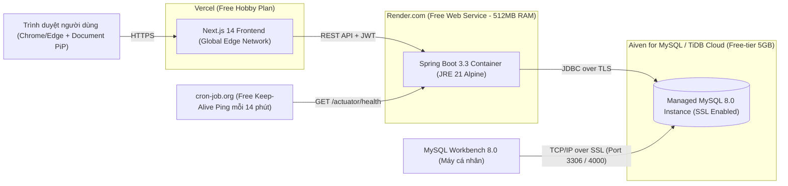

# Deployment Specification (100% Free-tier Strategy) - OmniLife Personal OS

## 1. Kiến Trúc Hạ Tầng Đám Mây Miễn Phí 100% (Zero-Cost Cloud Topology)

Để đảm bảo sinh viên có thể vận hành dự án lâu dài phục vụ sử dụng cá nhân hàng ngày mà **không tốn bất kỳ chi phí thuê máy chủ nào (0 VNĐ/tháng)**, hệ thống sử dụng tổ hợp 4 nền tảng Free-tier bền vững nhất hiện nay:



---

## 2. Cấu Hình Docker Hóa Tối Ưu Bộ Nhớ (`Dockerfile` & `docker-compose.yml`)

### 2.1. Tối Ưu Hóa `backend/Dockerfile` Cho Gói 512MB RAM Của Render Free-tier
Gói miễn phí của Render giới hạn bộ nhớ ở mức `512MB RAM`. Nếu chạy JVM mặc định, Spring Boot rất dễ gặp lỗi `OutOfMemoryError (Killed)`. Do đó, `backend/Dockerfile` bắt buộc sử dụng **Multi-stage Build** với `eclipse-temurin:21-jre-alpine` và cấu hình tham số JVM `-XX:MaxRAMPercentage=70.0 -XX:+UseSerialGC -Xss512k`:

```dockerfile
# ===================================================================
# STAGE 1: BUILD STAGE (MAVEN + JDK 21 ALPINE)
# ===================================================================
FROM eclipse-temurin:21-jdk-alpine AS builder
WORKDIR /workspace/app

COPY mvnw .
COPY .mvn .mvn
COPY pom.xml .

RUN chmod +x ./mvnw && ./mvnw dependency:go-offline -B

COPY src src
RUN ./mvnw clean package -DskipTests -B

# ===================================================================
# STAGE 2: PRODUCTION RUNTIME (JRE 21 ALPINE - ULTRA LIGHTWEIGHT)
# ===================================================================
FROM eclipse-temurin:21-jre-alpine
WORKDIR /app

RUN addgroup -S omnilife && adduser -S omnilife -G omnilife
USER omnilife:omnilife

COPY --from=builder /workspace/app/target/*.jar app.jar

EXPOSE 8080

# Tối ưu hóa JVM để chạy ổn định trong giới hạn 512MB RAM của Render Free-tier
ENTRYPOINT ["java", \
  "-XX:+UseContainerSupport", \
  "-XX:MaxRAMPercentage=70.0", \
  "-XX:+UseSerialGC", \
  "-Xss512k", \
  "-Djava.security.egd=file:/dev/./urandom", \
  "-Duser.timezone=UTC", \
  "-jar", "app.jar"]
```

### 2.2. Cấu Hình `docker-compose.yml` Tại Thư Mục Gốc (Chạy Local Toàn Hệ Thống)

```yaml
version: '3.9'

services:
  omnilife-mysql:
    image: mysql:8.0
    container_name: omnilife-mysql
    restart: unless-stopped
    environment:
      MYSQL_ROOT_PASSWORD: root_password_2026
      MYSQL_DATABASE: omnilife_db
      TZ: UTC
    ports:
      - "3306:3306"
    volumes:
      - mysql_data:/var/lib/mysql
    command:
      - --character-set-server=utf8mb4
      - --collation-server=utf8mb4_unicode_ci
      - --default-time-zone=+00:00
    healthcheck:
      test: ["CMD", "mysqladmin", "ping", "-h", "localhost", "-u", "root", "-proot_password_2026"]
      interval: 10s
      timeout: 5s
      retries: 5

  omnilife-backend:
    build:
      context: ./backend
      dockerfile: Dockerfile
    container_name: omnilife-backend
    restart: unless-stopped
    depends_on:
      omnilife-mysql:
        condition: service_healthy
    ports:
      - "8080:8080"
    environment:
      SPRING_PROFILES_ACTIVE: local
      DB_HOST: omnilife-mysql
      DB_PORT: 3306
      DB_NAME: omnilife_db
      DB_USERNAME: root
      DB_PASSWORD: root_password_2026
      JWT_SECRET_KEY: 7f8a9b0c1d2e3f4a5b6c7d8e9f0a1b2c3d4e5f6a7b8c9d0e1f2a3b4c5d6e7f8a
      APP_FRONTEND_URL: http://localhost:3000
      APP_CORS_ALLOWED_ORIGINS: http://localhost:3000

volumes:
  mysql_data:
```

---

## 3. Hướng Dẫn Triển Khai Từng Bước (Step-by-Step Deployment Guide)

### Bước 1: Khởi Tạo Cloud MySQL Miễn Phí & Kết Nối Với MySQL Workbench
1. Đăng ký tài khoản miễn phí tại **Aiven.io** (hoặc **TiDB Cloud Serverless** - không yêu cầu thẻ tín dụng).
2. Chọn tạo dịch vụ **MySQL 8.0 (Free Plan - 5GB Storage, 1GB RAM)**.
3. Sau khi khởi tạo xong, lấy các thông số: `Host`, `Port`, `User`, `Password`, và tải chứng chỉ `ca.pem`.
4. **Kết nối trực tiếp từ MySQL Workbench trên máy tính của bạn:**
   - Mở MySQL Workbench -> Nhấn dấu `+` tạo kết nối mới (`OmniLife Cloud DB`).
   - Nhập `Hostname`, `Port`, `Username`, `Password`.
   - Chuyển sang tab **SSL**: Chọn `Use SSL: Require and Verify CA` và trỏ đường dẫn tới file `ca.pem`.
   - Nhấn **Test Connection** -> Tạo schema `omnilife_db`.

### Bước 2: Thiết Lập Google OAuth2 Miễn Phí Trên Google Cloud Console
1. Truy cập `https://console.cloud.google.com/`, tạo Project mới tên `OmniLife-Personal-OS`.
2. Vào mục **APIs & Services -> OAuth consent screen**:
   - Chọn **External**, điền tên ứng dụng `OmniLife OS`.
   - Trong phần **Scopes**, thêm `email`, `profile`, `openid` và `https://www.googleapis.com/auth/calendar.readonly`.
   - Trong phần **Test users**, thêm địa chỉ Gmail cá nhân của bạn.
3. Vào mục **Credentials -> Create Credentials -> OAuth client ID**:
   - Application type: **Web application**.
   - **Authorized JavaScript origins:**
     - `http://localhost:3000`
     - `https://omnilife-os.vercel.app`
   - **Authorized redirect URIs:**
     - `http://localhost:8080/login/oauth2/code/google`
     - `https://omnilife-api.onrender.com/login/oauth2/code/google`
4. Lưu lại `Client ID` và `Client Secret`.

### Bước 3: Triển Khai Spring Boot Backend Lên Render.com (Free Plan)
1. Đăng nhập vào `https://render.com/` bằng tài khoản GitHub.
2. Chọn **New -> Web Service** -> Kết nối tới repository `omnilife`.
3. Cấu hình dịch vụ:
   - **Name:** `omnilife-api`
   - **Root Directory:** `backend`
   - **Environment:** `Docker`
   - **Dockerfile Path:** `./Dockerfile`
   - **Instance Type:** `Free (0.1 CPU, 512MB RAM, $0/month)`
   - **Health Check Path:** `/actuator/health`
4. Thiết lập các biến môi trường Production (Environment Variables trên Render):

| Tên Biến (Key) | Giá Trị (Production Value) |
| :--- | :--- |
| `SPRING_PROFILES_ACTIVE` | `prod` |
| `SERVER_PORT` | `8080` |
| `DB_HOST` | `<host-mysql-cua-ban-tren-aiven>` |
| `DB_PORT` | `<port-mysql-tren-aiven>` |
| `DB_NAME` | `omnilife_db` |
| `DB_USERNAME` | `avnadmin` |
| `DB_PASSWORD` | `<mat-khau-mysql-aiven>` |
| `JWT_SECRET_KEY` | `<chuoi-ngau-nhien-64-ky-tu>` |
| `JWT_REFRESH_COOKIE_SECURE` | `true` |
| `GOOGLE_CLIENT_ID` | `<google-client-id>` |
| `GOOGLE_CLIENT_SECRET` | `<google-client-secret>` |
| `GOOGLE_REDIRECT_URI` | `https://omnilife-api.onrender.com/login/oauth2/code/google` |
| `APP_FRONTEND_URL` | `https://omnilife-os.vercel.app` |
| `APP_CORS_ALLOWED_ORIGINS` | `https://omnilife-os.vercel.app` |

5. **Mẹo giữ Backend không bị ngủ (Keep-Alive chống Cold Start):**
   - Gói miễn phí của Render sẽ tự động ngủ sau 15 phút không có request.
   - Hãy tạo một tài khoản miễn phí trên `https://cron-job.org/`, đặt lịch gọi `GET https://omnilife-api.onrender.com/actuator/health` mỗi **14 phút/lần** từ 06:00 sáng đến 24:00 đêm. Nhờ đó, ứng dụng của bạn luôn phản hồi tức thì dưới `100ms` suốt cả ngày.

### Bước 4: Triển Khai Next.js 14 Frontend Lên Vercel (Free Plan)
1. Đăng nhập vào `https://vercel.com/` bằng GitHub -> Chọn **Add New Project** -> Chọn repo `omnilife`.
2. Cấu hình Build:
   - **Framework Preset:** `Next.js`
   - **Root Directory:** `frontend`
   - **Build Command:** `npm run build`
   - **Install Command:** `npm install`
3. Thêm biến môi trường trên Vercel:
   - `NEXT_PUBLIC_API_BASE_URL` = `https://omnilife-api.onrender.com/api/v1`
   - `NEXT_PUBLIC_OAUTH2_GOOGLE_AUTH_URL` = `https://omnilife-api.onrender.com/oauth2/authorization/google`
4. Nhấn **Deploy**. Vercel sẽ cấp phát chứng chỉ HTTPS tự động (Bắt buộc phải có HTTPS thì trình duyệt mới cho phép kích hoạt cửa sổ nổi `window.documentPictureInPicture`).
