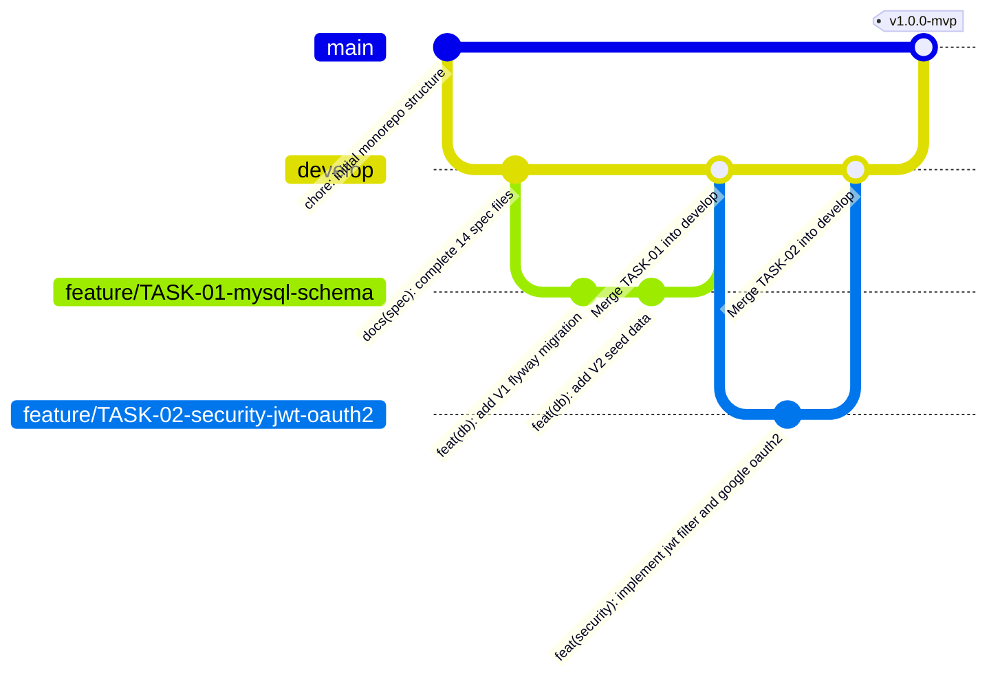

# Git Workflow & Version Control Specification - OmniLife Personal OS

## 1. Chiến Lược Phân Nhánh (Branching Strategy)

Dự án **OmniLife** áp dụng mô hình **GitHub Flow kết hợp Feature Branching** được tối ưu hóa cho lập trình viên phát triển độc lập (Solo Developer) nhưng vẫn tuân thủ nghiêm ngặt quy chuẩn làm việc tại các công ty công nghệ:



### 1.1. Các Nhánh Cốt Lõi (Permanent Branches)
1. **`main` (Production Branch):**
   - Luôn ở trạng thái ổn định, vượt qua 100% bài kiểm thử (JUnit 5 & Next.js Type-check).
   - Không bao giờ commit trực tiếp lên nhánh `main`. Chỉ nhận mã nguồn thông qua Pull Request từ nhánh `develop` hoặc nhánh `hotfix/*`.
   - Mỗi lần gộp code vào `main` sẽ được gắn thẻ phiên bản Semantic Versioning (`v0.1.0`, `v0.2.0`, `v1.0.0`) và kích hoạt tự động triển khai lên Render & Vercel.
2. **`develop` (Integration Branch):**
   - Nhánh tích hợp chính trong quá trình phát triển hàng ngày.
   - Mọi nhánh tính năng (`feature/*`) đều được tách ra từ `develop` và gộp ngược về `develop` sau khi hoàn thành từng Task trong `roadmap.md`.

### 1.2. Các Nhánh Tạm Thời (Supporting Branches)
Quy ước đặt tên nhánh sử dụng chữ thường, nối bằng dấu gạch ngang (`kebab-case`) và gắn kèm mã Task từ `roadmap.md`:

| Loại nhánh | Cấu trúc đặt tên | Ví dụ thực tế trong dự án | Mục đích |
| :--- | :--- | :--- | :--- |
| **Feature** | `feature/TASK-<id>-<ten-ngan-gon>` | `feature/TASK-06-urgency-scoring-engine` | Phát triển tính năng mới theo từng Task trong Roadmap |
| **Bugfix** | `fix/<mo-ta-loi>` | `fix/task-optimistic-lock-conflict` | Sửa lỗi phát hiện trong quá trình phát triển trên `develop` |
| **Hotfix** | `hotfix/<mo-ta-loi-khan-cap>` | `hotfix/google-oauth2-redirect-uri` | Sửa lỗi khẩn cấp phát sinh trên môi trường `main` (Production) |
| **Docs** | `docs/<noi-dung-tai-lieu>` | `docs/update-mysql-explain-benchmark` | Cập nhật tài liệu kiến trúc hoặc sơ đồ MySQL Workbench |
| **Refactor** | `refactor/<pham-vi-toi-uu>` | `refactor/eliminate-study-n-plus-one-query` | Tối ưu hóa cấu trúc code hoặc câu truy vấn JPA mà không đổi nghiệp vụ |

---

## 2. Quy Chuẩn Viết Commit Message (Conventional Commits)

Mọi commit message bắt buộc tuân thủ chuẩn **Conventional Commits v1.0.0**:

```text
<type>(<scope>): <subject>

[optional body]

[optional footer(s)]
```

### 2.1. Danh mục `<type>` hợp lệ
- `feat`: Thêm mới một tính năng hoặc API endpoint.
- `fix`: Sửa một lỗi nghiệp vụ, lỗi giao diện hoặc lỗi truy vấn SQL.
- `refactor`: Tái cấu trúc mã nguồn (ví dụ: áp dụng Strategy Pattern, tách DTO Projection) không làm thay đổi hành vi bên ngoài.
- `perf`: Tối ưu hóa hiệu năng (ví dụ: thêm Composite Index, bật `@Transactional(readOnly = true)`, cấu hình Caffeine Cache).
- `test`: Thêm mới hoặc cập nhật Unit Test / Integration Test (JUnit 5, Mockito).
- `docs`: Cập nhật tài liệu trong thư mục `docs/` hoặc Javadoc/OpenAPI.
- `chore`: Cập nhật cấu hình `pom.xml`, `package.json`, Docker, GitHub Actions.

### 2.2. Danh mục `<scope>` theo Module của OmniLife
- `db`: Thay đổi Flyway migration (`V1__`, `V2__`) hoặc file MySQL Workbench.
- `security`: Spring Security 6, JWT Filter, Google OAuth2.
- `user`: Quản lý hồ sơ và cấu hình cá nhân (`user_preferences`).
- `productivity`: Lịch biểu, Công việc, Subtasks, Pomodoro và Động cơ tính điểm khẩn cấp.
- `hud`: Cửa sổ nổi Always-on-Top Mini HUD (Document Picture-in-Picture).
- `study`: Học kỳ, Môn học, Trích xuất tài liệu PDF và Thuật toán Spaced Repetition SM-2.
- `finance`: Ví tiền, Danh mục, Giao dịch sổ cái và Ngân sách tháng.
- `habit`: Thói quen, Điểm danh thể thao và Biểu đồ nhiệt 365 ngày.
- `journal`: Nhật ký Markdown, Chỉ số cảm xúc và Daily Activity Snapshot.
- `audio`: Trình phát nhạc Lo-Fi và bộ trộn âm thanh trắng.

### 2.3. Quy tắc viết `<subject>`
1. Viết bằng tiếng Anh ngắn gọn (dưới 72 ký tự).
2. Sử dụng động từ nguyên mẫu ở thì hiện tại (`add`, `implement`, `fix`, `optimize` — không dùng `added`, `fixed`).
3. Không viết hoa chữ cái đầu tiên của `<subject>` và không đặt dấu chấm ở cuối dòng.

### 2.4. Ví dụ Commit Message Chuẩn
```text
feat(productivity): implement dynamic urgency score calculation engine

- Calculate time decay factor using non-linear hyperbolic curve
- Add scheduled job running every 15 minutes to update urgency tiers
- Ref: TASK-06
```

```text
fix(finance): apply pessimistic write lock on wallet balance updates

- Prevent lost update race condition when recording concurrent transactions
- Add JUnit 5 concurrency test case with CountDownLatch
- Ref: TASK-11
```

---

## 3. Quy Trình Thực Thi Một Task Chuẩn (Standard Task Lifecycle)

Khi bắt đầu bất kỳ một Task nào trong `roadmap.md` (ví dụ `TASK-06`):

1. **Bước 1 - Cập nhật nhánh gốc và tách nhánh mới:**
   ```bash
   git checkout develop
   git pull origin develop
   git checkout -b feature/TASK-06-urgency-scoring-engine
   ```
2. **Bước 2 - Cập nhật trạng thái trong `worklog.md`:**
   - Đổi trạng thái của `TASK-06` từ `TODO` sang `IN_PROGRESS`.
3. **Bước 3 - Hiện thực hóa mã nguồn & Kiểm thử:**
   - Viết code theo đúng yêu cầu kỹ thuật trong `roadmap.md`.
   - Chạy kiểm thử tự động:
     - Với Backend: `./mvnw clean test`
     - Với Frontend: `npm run lint && npm run build`
4. **Bước 4 - Cập nhật `worklog.md` sang `DONE` và Commit:**
   ```bash
   git status
   git add .
   git commit -m "feat(productivity): implement dynamic urgency scoring engine (TASK-06)"
   ```
5. **Bước 5 - Gộp nhánh về `develop`:**
   ```bash
   git checkout develop
   git merge --no-ff feature/TASK-06-urgency-scoring-engine
   git push origin develop
   ```

---

## 4. Nguyên Tắc An Toàn Git (Git Safety Rules)

1. **Tuyệt đối không commit thông tin nhạy cảm:** Không bao giờ đưa file `.env`, `.env.local`, mật khẩu MySQL thật, `GOOGLE_CLIENT_SECRET` hay `JWT_SECRET_KEY` vào lịch sử Git.
2. **Không dùng lệnh phá hủy lịch sử trên nhánh chung:** Cấm chạy `git push --force` hoặc `git reset --hard` trên hai nhánh `main` và `develop`.
3. **Kiểm tra `git diff` trước mỗi lần commit:** Luôn rà soát lại các dòng code thay đổi để đảm bảo không sót các đoạn `System.out.println` hay `console.log` tạm thời.
